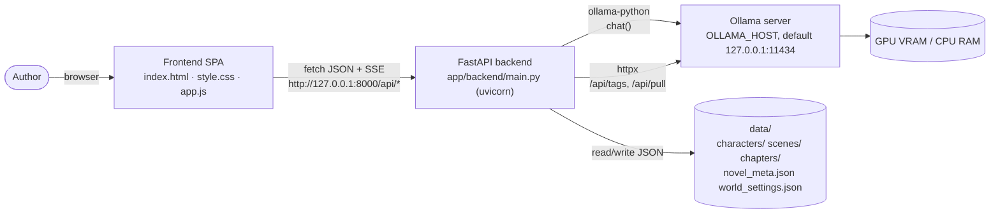
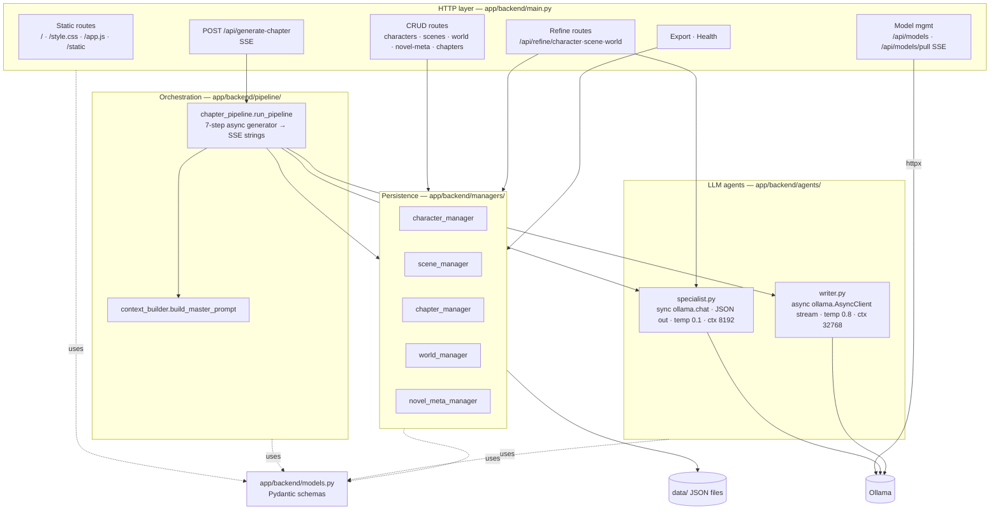

# 01 — Overview & Architecture

> **Applies to:** v2.0.0 + [Unreleased] (first documented at v1.0.0, commit `dead3e3`). **Last verified against code:** 2026-11-23 (§8 process model, plan 010; §6 specialist `keep_alive`, plan 013); 2026-11-24 (§2–4 and §7 fonts, plan 014; Ollama address, export and §4 rule 2, plan 015; §7 tree and §8, plan 016; §7 `data/` and `style.css`, §9 input and HTML rows, plan 017).
> Code is the source of truth. If this document disagrees with the code, the code wins — and this document must be fixed (see [docs/ai/RULES.md](../ai/RULES.md)).

---

## 1. What the tool is

**NovelForge AI** (repository folder: `AI_Writer`) is a **local, single-user, AI-assisted light-novel writing application**.
The author types a short plot description for the next chapter; a multi-step LLM pipeline running on the author's own machine (through **Ollama**) turns it into a ~2,000-word chapter. While doing so it:

- discovers characters and locations that are mentioned in the plot and creates structured profiles for new ones,
- assembles a context window from the world settings, relevant character/location profiles and tiered summaries of earlier chapters,
- streams the chapter text to the browser token by token,
- summarises the finished chapter (micro / short / full summaries) and updates character profiles for continuity in later chapters.

Besides chapter generation it offers:

| Capability | Where in the UI | Backend |
|---|---|---|
| Character "builder": rough description → structured profile (create or merge into existing) | Center panel → **Character Build** tab | `POST /api/refine/character` |
| Scene/location "builder" | Center panel → **Scene Build** tab | `POST /api/refine/scene` |
| World "builder": rough description → merged into world settings | Center panel → **World Build** tab | `POST /api/refine/world` |
| Manual CRUD of characters and locations | Left/right sidebars, edit modals | `/api/characters`, `/api/scenes` |
| Manual world settings editing | Right sidebar → **World Settings** | `GET/PUT /api/world` |
| Novel metadata + model selection | Header → **Settings** | `GET/PUT /api/novel-meta`, `GET /api/models` |
| Pull Ollama models from the UI with progress | Settings → model browser → **Pull** | `POST /api/models/pull` |
| Chapter history / reader | Bottom history bar, **Full View** modal | `GET /api/chapters`, `GET /api/chapters/{n}` |
| Export whole novel as `.txt` / `.md` | Header → **Export** | `GET /api/export/{fmt}` |

> ⚠ Some of these flows have verified defects (for example, a Build tab's **Update Existing** can save an invalid AI value that makes the entity unloadable, KI-016). See [09 — Known Issues](09-known-issues-and-tech-debt.md) before relying on a flow.

## 2. Key characteristics (design constraints)

| Characteristic | Detail |
|---|---|
| **Local-only** | Backend binds to `127.0.0.1:8000`; LLM inference goes to Ollama on `127.0.0.1:11434`, or wherever `OLLAMA_HOST` points (used for generation, the model list and pulls alike since plan 015). No cloud API is called, and the UI makes no outside request: its fonts are bundled in `app/frontend/fonts/` (plan 014, KI-034; before, they came from Google Fonts). |
| **Single user / single novel** | One `data/` folder = one novel. No accounts, no authentication, no multi-tenancy. |
| **No database** | All persistence is plain JSON files under `data/` (one file per character, scene and chapter). |
| **No build step** | Frontend is three static files (`index.html`, `style.css`, `app.js`), vanilla JS with no framework and no bundler. They are served by FastAPI. |
| **Dual-model ("two agent") design** | A small **specialist** model does structured-JSON analysis tasks, and a large **writer** model does prose. `keep_alive` values are chosen so both are not resident in VRAM at the same time (see §6). |
| **Streaming UX** | Generation progress and tokens are pushed to the browser over **Server-Sent Events** (SSE) on a `POST` response body (parsed manually with `fetch` + `ReadableStream`, not `EventSource`). |
| **Windows-first** | `app/start.bat` launcher. Backend code itself is cross-platform Python. |

## 3. Technology stack

| Layer | Technology | Version (lower bound in `app/requirements.txt`; verified with) | Notes |
|---|---|---|---|
| Runtime | Python | 3.11+ (verified on 3.14.5) | Every dependency resolves to a ready-made wheel on 3.14 (plan 005). |
| Web framework | FastAPI | `>=0.111` (0.141.1) | Async route handlers, Pydantic request validation, `StreamingResponse` for SSE. |
| ASGI server | Uvicorn `[standard]` | `>=0.30` (0.52.3) | Launched by `app/start.bat` as `python -m uvicorn main:app`. |
| Validation / models | Pydantic v2 | `>=2.9,<3` (2.13.4) | `model_dump()` used everywhere (v2 API). |
| LLM client | `ollama` (ollama-python) | `>=0.4,<1` (0.6.3) | Both agents use `ollama.AsyncClient`. Attribute access (`response.message.content`) needs ≥ 0.4, and ollama ≥ 0.4 itself needs pydantic ≥ 2.9. The import is optional at startup (KI-003). |
| HTTP client | `httpx` | `>=0.27` (0.28.1) | Used directly in `main.py` for `/api/tags` and `/api/pull`. |
| LLM runtime | Ollama server | any recent | HTTP API on `http://127.0.0.1:11434` by default; `OLLAMA_HOST` overrides it. |
| Frontend | HTML5 + CSS3 + vanilla ES2020 JS | — | Fonts *Cinzel* (display), *Crimson Pro* (body), *JetBrains Mono* (mono), self-hosted as woff2 under `app/frontend/fonts/` (SIL OFL 1.1, licences alongside; plan 014). |
| Launcher | Windows batch (`app/start.bat`) | — | Detects Python, checks every dependency (incl. ollama ≥ 0.4) and installs/upgrades if needed, starts server, polls health, opens browser. |

> **Dependencies (plan 005, D-009):** `app/requirements.txt` holds lower bounds plus a comment with the verified versions. In v1.0.0 it held stale exact pins (`ollama==0.3.3`, `pydantic==2.7.1`) that matched no working environment, and the backend could not even import without `ollama`. Both are fixed (KI-003, KI-004).

## 4. System context



## 5. Component architecture (backend)



### Dependency rules (as implemented)

1. `models.py` depends on nothing in the project. Every other module imports it.
2. `managers/*` depend only on `models` plus the standard library. **Managers are the only code that touches `data/`.** (Until plan 015 the export route also wrote files there, KI-017; it now serves the download from memory.)
3. `agents/*` depend on `models` and the `ollama` library. They never touch disk.
4. `pipeline/*` depends on managers, agents and models.
5. `main.py` depends on everything. The refine endpoints import `agents.specialist` lazily, inside the handler.
6. Imports are **flat, not package-relative** (`from models import …`). This works because `main.py:19` and `chapter_pipeline.py:13` insert `app/backend/` into `sys.path`, and uvicorn is started with `app/backend/` as the working directory. Keep this style unless you restructure the whole package.

## 6. The dual-model design and VRAM strategy

| Role | Default model | Used for | Ollama options | `keep_alive` |
|---|---|---|---|---|
| **Specialist** | `phi4-mini:3.8b` (`models.py:148`) | Plot analysis, entity resolution, profiling, post-write summarisation, refine endpoints | `num_ctx 8192`, `temperature 0.1` | `300` s (unloaded after 5 idle minutes) for steps 1–3 and the refine endpoints (plan 013, KI-029; was `-1`, stay loaded forever). **`0` (unload right away)** at step 5 (explicit `unload`: an empty `generate`, no generation) and after step 7 (`post_write_update`). |
| **Writer** | `gemma3:12b` (`models.py:147`) | Chapter prose (streamed) | `num_ctx 32768`, `temperature 0.8`, `top_p 0.9` | `300` seconds (stays warm for the next chapter) |

Timeline of one chapter generation:

```mermaid
gantt
    dateFormat X
    axisFormat %s
    title VRAM residency during one generation (illustrative)
    section Specialist
    Steps 1-3 (keep_alive 300s)      :a1, 0, 4
    Step 5 unload (keep_alive 0, nothing generated) :a2, 4, 5
    Step 7 post_write_update (load, then unload)  :a3, 9, 10
    section Writer
    Step 6 stream chapter (keep_alive 300s)        :b1, 5, 9
    Stays warm 5 min                                :b2, 9, 14
```



Step 5 only unloads the specialist, with Ollama's unload request (`generate` with an empty prompt and `keep_alive=0`), so no tokens are generated (plan 008; before, it ran a full prediction prompt whose result was never used, KI-012). Step 4 makes no LLM call. In step 7 the specialist is loaded again while the writer may still be resident (writer `keep_alive=300`), so peak VRAM can briefly include both models.

## 7. Directory structure

The repository has three areas, one purpose each (plan 002, decision D-007):

| Area | Holds | Open it when you… |
|---|---|---|
| `app/` | The application (code, launcher, dependencies) | change, fix, run or install the tool |
| `data/` | The novel (JSON files written by the app; local only, git-ignored since plan 017) | inspect or back up novel content |
| `docs/` | Everything written *about* the tool | read or update docs, plans, changelog, AI memory |

```
AI_Writer/
├── app/                                 APPLICATION
│   ├── backend/                         Python FastAPI application (run with CWD = app/backend/)
│   │   ├── __init__.py                  (comment only)
│   │   ├── main.py            (392 LOC) FastAPI app, all HTTP routes, static file serving, model mgmt, refine endpoints, export
│   │   ├── models.py           (97 LOC) Pydantic models: Character, Scene, WorldSettings, Chapter, NovelMeta + request wrappers
│   │   ├── agents/
│   │   │   ├── specialist.py  (367 LOC) 9 specialist LLM functions (JSON in/out) + robust JSON extraction
│   │   │   └── writer.py       (62 LOC) Streaming chapter writer (system prompt + async generator)
│   │   ├── managers/                    JSON-file persistence, one module per entity type (paths → <repo>/data/)
│   │   │   ├── __init__.py              re-exports the five managers
│   │   │   ├── storage.py               atomic JSON writes + logged skips, shared by the managers (plan 016)
│   │   │   ├── character_manager.py     data/characters/{slug}.json
│   │   │   ├── scene_manager.py         data/scenes/{slug}.json
│   │   │   ├── chapter_manager.py       data/chapters/{NNN}.json  (zero-padded to 3 digits)
│   │   │   ├── world_manager.py         data/world_settings.json
│   │   │   └── novel_meta_manager.py    data/novel_meta.json
│   │   └── pipeline/
│   │       ├── chapter_pipeline.py (249 LOC) 7-step orchestration, emits SSE strings
│   │       └── context_builder.py  (145 LOC) Builds the writer's master prompt (tiered memory)
│   ├── frontend/
│   │   ├── index.html         (830 LOC) App shell: header, 3-column layout, 4 mode tabs, pipeline UI, 6 modals
│   │   ├── app.js            (1890 LOC) All client logic (state, API helpers, rendering, SSE parsing, modals, model browser)
│   │   ├── style.css         (2439 LOC) Dark "glass" design system (CSS custom properties, animations; responsive breakpoints, plan 017)
│   │   └── fonts/                       Self-hosted woff2 fonts + fonts.css (@font-face) + OFL licences (plan 014)
│   ├── tests/                           pytest suite: API, storage, pipeline, helpers; fake ollama, temp data (plan 016)
│   ├── start.bat                        Windows launcher (double-click)
│   ├── requirements.txt                 Python dependencies (lower bounds; verified versions in a comment)
│   ├── requirements-dev.txt             dev-only tools: pytest, ruff (not needed to run the app)
│   └── pyproject.toml                   pytest + ruff settings only (the app is not a package)
├── data/                                NOVEL DATA (created/updated by the app; git-ignored since plan 017, not in the repository)
│   ├── characters/*.json
│   ├── scenes/*.json
│   ├── chapters/NNN.json                created on first generated chapter
│   ├── novel_meta.json
│   ├── world_settings.json
│   └── Untitled_Novel.txt               left by an older export; exports no longer write here (plan 015)
├── docs/                                SUPPORTING DOCUMENTS
│   ├── README.md                        map of docs/
│   ├── user-guide.md                    end-user guide (setup, usage, troubleshooting)
│   ├── CHANGELOG.md                     version history
│   ├── technical/                       ← this documentation set (01…09)
│   └── ai/                              AI workspace: RULES.md, plans/, memory/, templates/ (see docs/ai/README.md)
├── .claude/                             Claude Code project settings + workflow hooks (must stay at root)
├── .github/workflows/ci.yml             CI: lint + tests + JS syntax on push (GitHub requires this location; D-013)
├── CLAUDE.md                            loader that imports docs/ai/RULES.md (must stay at root)
├── AGENTS.md                            pointer for non-Claude AI tools (must stay at root)
├── README.md                            map of the repository
└── .gitignore
```

How the app finds its data from inside `app/`: each manager computes `Path(__file__).resolve().parents[3] / "data"`, i.e. the repo-root `data/` (see 05 §1). The export route no longer touches `data/` (plan 015). The frontend is served from `app/frontend/` (sibling of `app/backend/`, `main.py:51`). Stale `__pycache__/` folders (cpython-313) moved with the code. They are git-ignored, so the previously tracked copies drop out of git once the move is committed (KI-022).

## 8. Process & runtime model

- **One process, one worker.** `app/start.bat` runs `python -m uvicorn main:app --host 127.0.0.1 --port 8000` (no `--reload`) in a minimised window titled `NovelForge-Backend`, with the working directory set to `app/backend/`. Running `python main.py` instead starts uvicorn with `reload=True` (`main.py:530-532`).
- **Async LLM calls.** Route handlers are `async def`, and both agents use `ollama.AsyncClient`. The specialist functions are `async def` and awaited, so the server keeps answering other requests while a model works (fixed KI-005 in plan 005; before, the sync `ollama.chat` froze the server). File I/O in the managers is still synchronous, but it is small and fast. Every save goes through `managers/storage.write_json` (temp file + atomic replace, plan 016, KI-026).
- **One generation at a time** (plan 010, KI-031). The pipeline runs as an `asyncio.Task` that feeds the SSE response through a queue. While it runs, another `POST /api/generate-chapter` gets **409**.
  - `POST /api/generate-chapter/cancel` stops it.
  - A client disconnect cancels it too, so a generation still lives only as long as its HTTP response stream.
  - There are no other background jobs or locks.
- **Logging** (plan 016, KI-025). `main.py` configures console logging (`%(asctime)s %(levelname)s %(name)s: %(message)s`) next to uvicorn's own access log.
  - Logged: data files the managers can't read, pipeline `warning`/`error` events, specialist replies without JSON, failed model pulls and cancelled generations.
- **State.** All durable state is in `data/`. In memory, the server keeps only the module-level constant `RECOMMENDED_MODELS` and the running generation's task (`_generation`, `main.py:171`), which is gone after a restart.

## 9. Security posture (summary)

| Aspect | Current state |
|---|---|
| Network exposure | Bound to loopback (`127.0.0.1`) only. |
| Authentication | None. |
| Cross-site access | No CORS middleware: the UI calls `/api` on its own origin, so other websites can't call the API. `TrustedHostMiddleware` accepts only `Host: 127.0.0.1`/`localhost` (blocks DNS rebinding) (`main.py:43`). In v1.0.0 CORS was `*` (KI-010, fixed in plan 007). |
| Input → filesystem | Every file access goes through the managers' `_path(slug)`, which accepts only `[\w-]+` (`character_manager.py:9`, `:27`); new slugs are derived by the server. In v1.0.0 slugs became filenames unchecked (KI-010, fixed in plan 007). |
| HTML injection | Dynamic HTML goes through `escHtml()`, including the world snapshot and the model browser (`app.js:1519`, `:1740`). In v1.0.0 those two did not (KI-011, fixed in plan 007). |
| Secrets | None used or stored. |

## 10. Related documents

- [02 — Workflows](02-workflows.md): step-by-step flows, sequence diagrams.
- [03 — Low-Level Design](03-low-level-design.md): every module and function.
- [04 — API Reference](04-api-reference.md)
- [05 — Data Model & Storage](05-data-model-and-storage.md)
- [06 — Configuration](06-configuration.md)
- [07 — Setup & Usage](07-setup-and-usage.md)
- [08 — FAQ & Troubleshooting](08-faq-and-troubleshooting.md)
- [09 — Known Issues & Tech Debt](09-known-issues-and-tech-debt.md)
