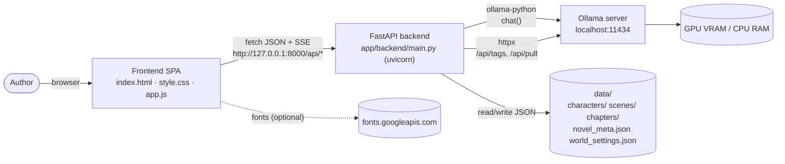
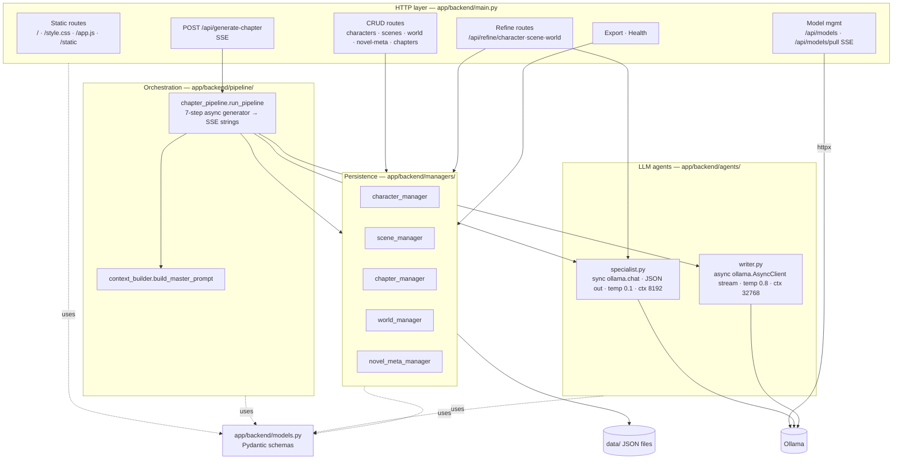

# 01 — Overview & Architecture

> **Applies to:** v1.0.0 (commit `dead3e3`). **Last verified against code:** 2026-11-22.
> Code is the source of truth. If this document disagrees with the code, the code wins — and this document must be fixed (see [docs/ai/RULES.md](../ai/RULES.md)).

---

## 1. What the tool is

**NovelForge AI** (repository folder: `AI_Writer`) is a **local, single-user, AI-assisted light-novel writing application**.
The author types a short plot description for the next chapter; a multi-step LLM pipeline running on the author's own machine (through **Ollama**) turns it into a ~2,000-word chapter. While doing so it:

- discovers characters and locations that are mentioned in the plot and creates structured profiles for new ones,
- assembles a context window from the world settings, relevant character/location profiles and tiered summaries of earlier chapters,
- streams the chapter text to the browser token by token,
- summarises the finished chapter (micro / short / full summaries) and updates character profiles for continuity in later chapters.

Besides chapter generation it offers:

| Capability | Where in the UI | Backend |
|---|---|---|
| Character "builder": rough description → structured profile (create or merge into existing) | Center panel → **Character Build** tab | `POST /api/refine/character` |
| Scene/location "builder" | Center panel → **Scene Build** tab | `POST /api/refine/scene` |
| World "builder": rough description → merged into world settings | Center panel → **World Build** tab | `POST /api/refine/world` |
| Manual CRUD of characters and locations | Left/right sidebars, edit modals | `/api/characters`, `/api/scenes` |
| Manual world settings editing | Right sidebar → **World Settings** | `GET/PUT /api/world` |
| Novel metadata + model selection | Header → **Settings** | `GET/PUT /api/novel-meta`, `GET /api/models` |
| Pull Ollama models from the UI with progress | Settings → model browser → **Pull** | `POST /api/models/pull` |
| Chapter history / reader | Bottom history bar, **Full View** modal | `GET /api/chapters`, `GET /api/chapters/{n}` |
| Export whole novel as `.txt` / `.md` | Header → **Export** | `GET /api/export/{fmt}` |

> ⚠ Some of these flows have verified defects in v1.0.0 (for example, manual character/location save is rejected with HTTP 422). See [09 — Known Issues](09-known-issues-and-tech-debt.md) before relying on a flow.

## 2. Key characteristics (design constraints)

| Characteristic | Detail |
|---|---|
| **Local-only** | Backend binds to `127.0.0.1:8000`; LLM inference goes to Ollama on `localhost:11434`. No cloud API is called. (Fonts are loaded from Google Fonts. Without internet they fall back to Georgia/Consolas.) |
| **Single user / single novel** | One `data/` folder = one novel. No accounts, no authentication, no multi-tenancy. |
| **No database** | All persistence is plain JSON files under `data/` (one file per character, scene and chapter). |
| **No build step** | Frontend is three static files (`index.html`, `style.css`, `app.js`), vanilla JS with no framework and no bundler. They are served by FastAPI. |
| **Dual-model ("two agent") design** | A small **specialist** model does structured-JSON analysis tasks, and a large **writer** model does prose. `keep_alive` values are chosen so both are not resident in VRAM at the same time (see §6). |
| **Streaming UX** | Generation progress and tokens are pushed to the browser over **Server-Sent Events** (SSE) on a `POST` response body (parsed manually with `fetch` + `ReadableStream`, not `EventSource`). |
| **Windows-first** | `app/start.bat` launcher. Backend code itself is cross-platform Python. |

## 3. Technology stack

| Layer | Technology | Version (pinned in `app/requirements.txt`) | Notes |
|---|---|---|---|
| Runtime | Python | README says 3.11+ | Committed bytecode is `cpython-313`. The current dev machine has Python 3.14. |
| Web framework | FastAPI | `0.111.0` | Async route handlers, Pydantic request validation, `StreamingResponse` for SSE. |
| ASGI server | Uvicorn `[standard]` | `0.30.1` | Launched by `app/start.bat` as `python -m uvicorn main:app`. |
| Validation / models | Pydantic v2 | `2.7.1` | `model_dump()` used everywhere (v2 API). |
| LLM client | `ollama` (ollama-python) | `0.3.3` | ⚠ The code uses attribute access (`response.message.content`), which needs ollama-python **≥ 0.4**. See KI-004. |
| HTTP client | `httpx` | *not pinned* (comes in transitively with `ollama`) | Used directly in `main.py` for `/api/tags` and `/api/pull`. |
| Unused pins | `aiofiles==23.2.1`, `python-multipart==0.0.9` | — | Not imported by project code. |
| LLM runtime | Ollama server | any recent | HTTP API on `http://localhost:11434`. |
| Frontend | HTML5 + CSS3 + vanilla ES2020 JS | — | Google Fonts: *Cinzel* (display), *Crimson Pro* (body), *JetBrains Mono* (mono). |
| Launcher | Windows batch (`app/start.bat`) | — | Detects Python, installs deps, starts server, polls health, opens browser. |

> **Environment drift (verified 2026-11-22):** The pins in `app/requirements.txt` do not match any environment observed to work. The dev machine has FastAPI 0.141.1, Pydantic 2.13.4, Uvicorn 0.52.3, httpx 0.28.1 and **no `ollama` package**, so the backend fails to import (`ModuleNotFoundError: ollama` from `app/backend/agents/writer.py:5`). See KI-003/KI-004.

## 4. System context



## 5. Component architecture (backend)



### Dependency rules (as implemented)

1. `models.py` depends on nothing in the project. Every other module imports it.
2. `managers/*` depend only on `models` plus the standard library. **Managers are the only code that touches `data/`.** One exception: `main.py:210` writes export files into `data/` directly.
3. `agents/*` depend on `models` and the `ollama` library. They never touch disk.
4. `pipeline/*` depends on managers, agents and models.
5. `main.py` depends on everything. The refine endpoints import `agents.specialist` lazily, inside the handler.
6. Imports are **flat, not package-relative** (`from models import …`). This works because `main.py:13` and `chapter_pipeline.py:12` insert `app/backend/` into `sys.path`, and uvicorn is started with `app/backend/` as the working directory. Keep this style unless you restructure the whole package.

## 6. The dual-model design and VRAM strategy

| Role | Default model | Used for | Ollama options | `keep_alive` |
|---|---|---|---|---|
| **Specialist** | `phi4-mini:3.8b` (`models.py:75`) | Plot analysis, entity resolution, profiling, context selection, update prediction, post-write summarisation, refine endpoints | `num_ctx 8192`, `temperature 0.1` | `-1` (stay loaded) for steps 1–4 and the refine endpoints. **`0` (unload right away)** for step 5 (`predict_updates`) and step 7 (`post_write_update`). |
| **Writer** | `gemma3:12b` (`models.py:74`) | Chapter prose (streamed) | `num_ctx 32768`, `temperature 0.8`, `top_p 0.9` | `300` seconds (stays warm for the next chapter) |

Timeline of one chapter generation:


Step 5 exists mainly to unload the specialist: its prediction result is **never used** (KI-012). In step 7 the specialist is loaded again while the writer may still be resident (writer `keep_alive=300`), so peak VRAM can briefly include both models.

## 7. Directory structure

The repository has three areas, one purpose each (plan 002, decision D-007):

| Area | Holds | Open it when you… |
|---|---|---|
| `app/` | The application (code, launcher, dependencies) | change, fix, run or install the tool |
| `data/` | The novel (JSON files written by the app) | inspect or back up novel content |
| `docs/` | Everything written *about* the tool | read or update docs, plans, changelog, AI memory |

```
AI_Writer/
├── app/                                 APPLICATION
│   ├── backend/                         Python FastAPI application (run with CWD = app/backend/)
│   │   ├── __init__.py                  (comment only)
│   │   ├── main.py            (392 LOC) FastAPI app, all HTTP routes, static file serving, model mgmt, refine endpoints, export
│   │   ├── models.py           (97 LOC) Pydantic models: Character, Scene, WorldSettings, Chapter, NovelMeta + request wrappers
│   │   ├── agents/
│   │   │   ├── specialist.py  (367 LOC) 9 specialist LLM functions (JSON in/out) + robust JSON extraction
│   │   │   └── writer.py       (62 LOC) Streaming chapter writer (system prompt + async generator)
│   │   ├── managers/                    JSON-file persistence, one module per entity type (paths → <repo>/data/)
│   │   │   ├── __init__.py              re-exports the five managers
│   │   │   ├── character_manager.py     data/characters/{slug}.json
│   │   │   ├── scene_manager.py         data/scenes/{slug}.json
│   │   │   ├── chapter_manager.py       data/chapters/{NNN}.json  (zero-padded to 3 digits)
│   │   │   ├── world_manager.py         data/world_settings.json
│   │   │   └── novel_meta_manager.py    data/novel_meta.json
│   │   └── pipeline/
│   │       ├── chapter_pipeline.py (249 LOC) 7-step orchestration, emits SSE strings
│   │       └── context_builder.py  (145 LOC) Builds the writer's master prompt (tiered memory)
│   ├── frontend/
│   │   ├── index.html         (830 LOC) App shell: header, 3-column layout, 4 mode tabs, pipeline UI, 6 modals
│   │   ├── app.js            (1884 LOC) All client logic (state, API helpers, rendering, SSE parsing, modals, model browser)
│   │   └── style.css         (2381 LOC) Dark "glass" design system (CSS custom properties, animations; no media queries)
│   ├── start.bat                        Windows launcher (double-click)
│   └── requirements.txt                 Python dependencies (⚠ stale pins, KI-004)
├── data/                                NOVEL DATA (created/updated by the app; sample content is committed)
│   ├── characters/*.json
│   ├── scenes/*.json
│   ├── chapters/NNN.json                created on first generated chapter (absent in repo)
│   ├── novel_meta.json
│   ├── world_settings.json
│   └── <Title>.txt|.md                  export side-effect files (e.g. Untitled_Novel.txt)
├── docs/                                SUPPORTING DOCUMENTS
│   ├── README.md                        map of docs/
│   ├── user-guide.md                    end-user guide (setup, usage, troubleshooting)
│   ├── CHANGELOG.md                     version history
│   ├── technical/                       ← this documentation set (01…09)
│   └── ai/                              AI workspace: RULES.md, plans/, memory/, templates/ (see docs/ai/README.md)
├── .claude/                             Claude Code project settings + workflow hooks (must stay at root)
├── CLAUDE.md                            loader that imports docs/ai/RULES.md (must stay at root)
├── AGENTS.md                            pointer for non-Claude AI tools (must stay at root)
├── README.md                            map of the repository
└── .gitignore
```

How the app finds its data from inside `app/`: each manager computes `Path(__file__).resolve().parents[3] / "data"`, and `main.py`'s export uses `parents[2]`, i.e. the repo-root `data/` (see 05 §1). The frontend is served from `app/frontend/` (sibling of `app/backend/`, `main.py:40`). Stale `__pycache__/` folders (cpython-313) moved with the code. They are git-ignored, so the previously tracked copies drop out of git once the move is committed (KI-022).

## 8. Process & runtime model

- **One process, one worker.** `app/start.bat` runs `python -m uvicorn main:app --host 127.0.0.1 --port 8000` (no `--reload`) in a minimised window titled `NovelForge-Backend`, with the working directory set to `app/backend/`. Running `python main.py` instead starts uvicorn with `reload=True` (`main.py:390-392`).
- **Async, with blocking parts.** Route handlers are `async def`. The specialist uses the **synchronous** `ollama.chat`, so each specialist call blocks the event loop. While one runs, the server cannot answer other requests (KI-005). Writer streaming uses `ollama.AsyncClient` and does not block.
- **No background jobs, queues or locks.** A generation lives exactly as long as its HTTP response stream. Two generations at once are not prevented on the server; the frontend blocks a second one only within the same tab (`state.isGenerating`).
- **State.** All durable state is in `data/`. The server keeps no in-memory state between requests, apart from the module-level constant `RECOMMENDED_MODELS`.

## 9. Security posture (summary)

| Aspect | Current state |
|---|---|
| Network exposure | Bound to loopback (`127.0.0.1`) only. |
| Authentication | None. |
| CORS | `allow_origins=["*"]`, all methods and headers (`main.py:32-37`). Any web page open in the same browser can call the local API. |
| Input → filesystem | `slug` values (from the URL path, request bodies or LLM output) become filenames without sanitisation (KI-010). |
| HTML injection | Most rendering goes through `escHtml()`. The world snapshot and the model browser do not (KI-011). |
| Secrets | None used or stored. |

## 10. Related documents

- [02 — Workflows](02-workflows.md): step-by-step flows, sequence diagrams.
- [03 — Low-Level Design](03-low-level-design.md): every module and function.
- [04 — API Reference](04-api-reference.md)
- [05 — Data Model & Storage](05-data-model-and-storage.md)
- [06 — Configuration](06-configuration.md)
- [07 — Setup & Usage](07-setup-and-usage.md)
- [08 — FAQ & Troubleshooting](08-faq-and-troubleshooting.md)
- [09 — Known Issues & Tech Debt](09-known-issues-and-tech-debt.md)
