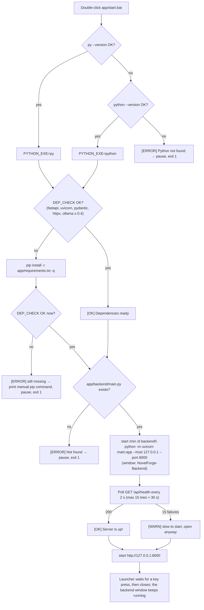
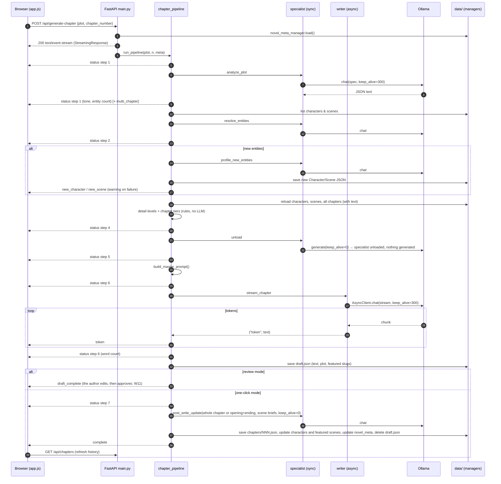
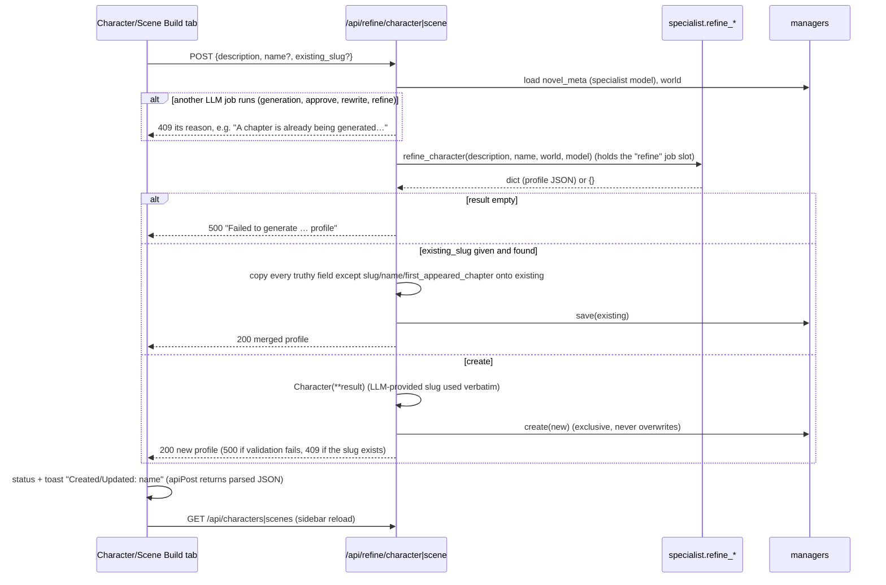

# 02 — Workflows

> **Applies to:** v2.0.0 + [Unreleased] (plan 019: draft review, @-mentions; plan 020: refine job guard, KI-042; plan 022: regenerating an earlier chapter, KI-043/KI-044; plan 023: partial chapters kept; plan 024: W13 ⟳ Regenerate, W9, W11). **Last verified against code:** 2026-11-27.
> Line references (`file:line`) point to v1.0.0 and will drift as code changes. Re-verify before relying on them.

This document describes every end-to-end flow in the application: what triggers it, which components take part, what data is read and written, and how failures behave.

| # | Workflow | Trigger |
|---|---|---|
| W1 | [Application launch](#w1--application-launch-appstartbat) | Double-click `app/start.bat` |
| W2 | [Frontend boot](#w2--frontend-boot) | Browser loads `/` |
| W3 | [Chapter generation (7-step pipeline)](#w3--chapter-generation-the-7-step-pipeline) | **▶ Generate Chapter**, `Ctrl+Enter`, `Alt+G` |
| W4 | [Character / Scene build (refine)](#w4--character--scene-build-refine) | **Refine & Save** buttons |
| W5 | [World build (refine + merge)](#w5--world-build-refine--merge) | **Integrate into World Settings** |
| W6 | [Manual CRUD of characters / locations](#w6--manual-crud-characters--locations) | Sidebar **+ New**, card **Edit/Delete** |
| W7 | [World settings & novel settings editing](#w7--world-settings--novel-settings-editing) | **World Settings**, **⚙ Settings**, title click |
| W8 | [Model management (list / select / pull)](#w8--model-management) | Opening Settings, **Refresh**, **Pull** |
| W9 | [Chapter history & reader](#w9--chapter-history--full-view-reader) | History pill, **⛶ Full View** |
| W10 | [Export](#w10--export) | **📤 Export → .txt / .md** |
| W11 | [Draft review (edit, AI rewrite, approve, discard)](#w11--draft-review-edit-ai-rewrite-approve-discard) | A generation in review mode, a draft left from a previous visit |
| W12 | [@-mentions in the plot box](#w12--mentions-in-the-plot-box) | Typing `@` in the plot textarea |
| W13 | [Regenerate a saved chapter](#w13--regenerate-a-saved-chapter) | **⟳ Regenerate** (chapter header, Full View) |

---

## W1 — Application launch (`app/start.bat`)

Notes:
- The dependency check (`DEP_CHECK`, `app/start.bat:40`) imports every runtime package and requires `ollama` ≥ 0.4, so a missing or too-old package triggers `pip install -r` (which also upgrades). If the packages are still missing afterwards (no network, pip error), the launcher stops with the manual command instead of starting a broken server. In v1.0.0 it probed only `fastapi` (KI-003, fixed in plan 005).
- Even without `ollama`, the backend itself now starts (the import is optional). Generation and the Build tabs then fail with "ollama Python package not installed: run pip install -r app/requirements.txt".
- To stop the app, close the minimised **NovelForge-Backend** window. The launcher has no stop command.

## W2 — Frontend boot

1. `GET /` → `serve_index()` reads `app/frontend/index.html` and returns it (`main.py:56-61`). The page then loads `/style.css` and `/app.js` through dedicated routes (`main.py:64-71`).
2. `DOMContentLoaded` listener #1 (`app.js:1481`):
   1. `checkConnection()` → `fetch /api/novel-meta` with a 3 s timeout. On a network failure it shows the toast *"⚠ Cannot connect to backend…"* for 8 s.
   2. `init()` → `bindStaticEvents()`, then runs these in parallel with `Promise.allSettled`: `loadNovelMeta`, `loadCharacters`, `loadScenes`, `loadWorld`, `loadChapters`. Then `loadDraft()` (`GET /api/draft`): a draft that waits for review opens again in the output section with an info toast (W11, plan 019). Then `updateChapterHint()`.
3. `DOMContentLoaded` listener #2 (`app.js:1920`) binds the mode tabs, the three refine buttons and **Refresh models**. (Until plan 006 it also added a second **⚙ Settings** click listener that loaded the models; `openSettingsModal` now does that itself.)
4. Each loader stores its result in `state.*` and renders: sidebars (character/scene cards), header title, chapter count badge, history pills, "CHAPTER N" label.
5. If a loader fails it logs `console.warn` and falls back to empty data. The UI stays usable.

## W3 — Chapter generation (the 7-step pipeline)

### W3.1 Trigger (frontend: `generateChapter()`, `app.js:421-584`)

1. Validates that the plot textarea is not empty and that no generation is running in this tab (`state.isGenerating`).
2. If a draft waits for review (`state.draft`), asks to discard it first (`discardDraft()`, W11); declining stops here (plan 019: one draft at a time).
3. Disables the button, shows **✕ Cancel** next to it, resets and shows the pipeline panel, hides the old output and the multi-chapter notice.
4. `POST`s `/api/generate-chapter` with `{plot, review, tagged_characters, tagged_scenes}`:
   - `review` is the **Review each chapter as a draft** setting (`novel_meta.review_drafts`, default on).
   - The tags are the entities picked with `@` (W12) whose names are still in the plot.
   - No chapter number is sent. The backend numbers the chapter itself (`get_next_number()`: highest existing number + 1, read from disk), so a gap or a stale page can't overwrite a chapter. The UI shows `nextChapterNumber()` (the same rule over `state.chapters`) while streaming and takes the real number from the `complete` or `draft_complete` event. (Before plan 006 it sent `count + 1`, which overwrote chapters after a gap: KI-008.)
5. A non-2xx response throws with the server's `detail`, shown as an error toast, for example the **409** "A chapter is already being generated…" (another tab or client is generating) or "A draft of chapter N is waiting for review…". After any error or cancel the UI calls `loadDraft()`, so a chapter kept as a draft appears (KI-041).
6. Reads the response body as a stream and parses SSE `data:` lines (`parseSSEStream`). Each JSON event is dispatched by its `type` (see W3.4).
7. **✕ Cancel** → `cancelGeneration()` (`app.js:587-596`) disables the button and `POST`s `/api/generate-chapter/cancel`. The stream then ends with the cancelled `error` event (W3.4). The `finally` block hides **Cancel** and re-enables **Generate** whichever way the run ends.

### W3.2 Backend entry (`main.py:180-217`)

- **One LLM job at a time** (plan 010, KI-031; widened in plans 019 and 020): `_busy_reason()` returns **409** while a generation task runs (`A chapter is already being generated. Wait for it to finish or cancel it.`), or while a draft approval, a passage rewrite or a Build-tab refine runs (`_job["kind"]`, claimed and released by the `_llm_job(kind)` context manager).
- **One draft at a time** (plan 019): if `data/draft.json` exists → **409** `A draft of chapter N is waiting for review. Approve or discard it first.`
- Loads `NovelMeta` from `data/novel_meta.json` to get the model names.
- `chapter_number = req.chapter_number or chapter_manager.get_next_number()`. The frontend sends no number (plan 006), so the backend picks highest + 1.
- Starts `produce()` as an `asyncio.Task` (stored in `_generation`): it iterates `run_pipeline(plot, n, meta, review, tagged_characters, tagged_scenes)` and puts each SSE string on an `asyncio.Queue`, then `None` when it ends. If the task is cancelled, it first queues `error {"message": "Generation cancelled", "cancelled": true}`.
- Returns `StreamingResponse(event_stream(), media_type="text/event-stream")` with headers `Cache-Control: no-cache`, `X-Accel-Buffering: no`, `Connection: keep-alive`. `event_stream()` yields the queued events until `None`.
- **Stopping:**
  - `POST /api/generate-chapter/cancel` sets `_cancel["by_user"]`, cancels the task and waits up to 5 s for it to finish, so the guard is free when it returns.
  - If the client disconnects, Starlette cancels the stream, and `event_stream()`'s `finally` cancels the task. Closing the tab therefore still stops the generation, as before plan 010.
  - **What a stop during step 6 keeps** (plan 023, D-018): `run_pipeline` gets `keep_partial_on_cancel=lambda: not _cancel["by_user"]`.
    - A closed or reloaded tab keeps the text written so far as the draft; the reloaded page opens it.
    - An explicit **✕ Cancel** discards it, as before.
  - Cancellation interrupts the pipeline at its current `await` (an Ollama call or a streamed token). Its `except Exception` doesn't catch `CancelledError`, so the open Ollama request is closed.

### W3.3 Pipeline steps (`app/backend/pipeline/chapter_pipeline.py`)

| Step | UI label | Code | LLM call (model, keep_alive) | Input | Output / side effects | SSE emitted |
|---|---|---|---|---|---|---|
| 1 | Analyze Plot | `:67-82` | `specialist.analyze_plot` (spec, 300) | plot | `tone`, `estimated_chapters`, `entity_mentions{characters[],locations[]}`, `key_events`, `chapter_focus` (only tone, estimated_chapters, entity_mentions are used; each is coerced: `estimated_chapters` numeric text → int, else 1; `tone` → text, else "action"; `entity_mentions` lists of strings only, plan 009, KI-015) | `status{step:1}` ×2. `multi_chapter` if `estimated_chapters > 1` |
| 2 | Extract Entities | `:84-97` | `specialist.resolve_entities` (spec, 300) | mentions + all existing `{name, slug}` pairs | `characters[]`/`scenes[]` with `{name, slug, status: existing\|new, importance}` The result is then canonicalised server-side (`_canonical_entities`, plan 007): matches by slug or name (ignoring case and `-`/`_`) become `existing` with the real slug, everything else `new` with `slug = make_slug(name)`; nameless entries and repeats are dropped. Then `_apply_tags` (plan 019): every `tagged_characters`/`tagged_scenes` slug that exists becomes `existing` with importance `primary`/`main` (added if the specialist missed it); unknown slugs are ignored and logged. | `status{step:2}` ×2 |
| 3 | Build Profiles | `:99-127` | `specialist.profile_new_entities` (spec, 300). **Skipped when nothing is new** | new names, plot, world brief, tone, chapter number | Creates `Character`/`Scene` objects with `slug = make_slug(profile name)` (never the LLM's slug) and **creates their files** in `data/` with `create()`, which never overwrites (also not an equivalent slug). A slug that already exists keeps the existing profile. | `status{step:3}`, `new_character{name,slug}`, `new_scene{name,slug}`, `warning{message}` on validation failure or an existing slug |
| — | (reload) | `:129-133` | — | — | Re-reads all characters and scenes into `chars_dict` / `scenes_dict` keyed by slug | — |
| 4 | Optimize Context | `:135-167` | **none** (deterministic since plan 008; the old `select_context` prompt only restated these rules, KI-013) | resolved entities with importance, all chapters | `character_detail{slug: full\|compressed}`, `scene_detail{slug: full\|skip}`, `chapter_tiers{"n": tier}`, built by the rules below | `status{step:4}` ×2 |
| 5 | Prepare Model | `:169-177` | `specialist.unload` → `AsyncClient.generate(model, keep_alive=0)`: Ollama's unload request, **no generation** (plan 008, KI-012) | specialist model name | Specialist leaves VRAM before the writer loads. Best-effort: a failure becomes a `warning` and the run continues | `status{step:5}` ×2, `warning{message}` if the unload fails |
| — | (prompt) | `:179-189` | — | world + dicts + chapters + detail maps | `master_prompt` string (see [03 §2.6](03-low-level-design.md#26-appbackendpipelinecontext_builderpy)) | — |
| 6 | Write Chapter | `writer.stream_chapter` loop | `writer.stream_chapter` (writer, 300 s, streaming) | master prompt, plot, chapter number | Tokens are appended to `full_text`. `word_count = len(full_text.split())`. Then the chapter is **saved as the draft** `data/draft.json` (plot, text, featured slugs, the slugs step 3 created) before anything else, in both modes (plan 019, KI-041) | `status{step:6}`, many `token{content}`, then `status{step:6}` "Chapter written: N words". A writer `error` ends the pipeline early: with text already written, that text is saved as the draft first and the event says `draft_saved: true` ("The N words written so far are kept as a draft"), and step 7 never runs on it; without text, nothing is saved. A cancel here keeps the text as the draft unless it was an explicit Cancel (plan 023) |
| ⏸ | (review mode) | `if review:` | — | `review: true` in the request | The pipeline **stops** here; step 7 runs when the author approves the draft (W11) | `draft_complete{…}` |
| 7 | Summarize & Save | `finalize_chapter()` | `specialist.post_write_update` (spec, **0**) | the **whole chapter**, or its opening + ending when it exceeds ~5000 tokens (`_chapter_excerpt`, plan 008, KI-014), primary character briefs, featured (main) scene briefs, all read from disk now | Saves `data/chapters/NNN.json`. Updates character `last_seen_chapter`, `arc_notes`, `cultivation_level`, `abilities` (set-union), `relationships` (dict update). Updates a featured scene's `significance` from `scene_updates` (non-empty text only, KI-013). Updates `novel_meta.total_chapters = max(old, n)`. **Deletes the draft last.** The same function runs for `POST /api/draft/approve` (plan 019) | `status{step:7}`, `warning` per failed character update, `complete{…}`. If the summary call fails: `error{…, draft_saved: true}` and the draft stays (KI-041) |
| ✖ | — | `except Exception` | — | any uncaught exception | Nothing further is saved. **Profiles already created in step 3 stay on disk**, and so does a draft saved after step 6. | `error{message, detail: traceback}` |

#### Step 4 rules (deterministic)

- **Characters:** `importance == "primary"` → `full`, otherwise → `compressed` (`:142-145`).
- **Scenes:** `importance == "main"` → `full`, otherwise → `skip` (`:146-149`).
- **Chapter tiers**, relative to the chapter being written `N`, for each existing chapter `n` (`:171-184`):

| `N − n` | Tier | What goes into the prompt |
|---|---|---|
| 1 | `full_text` | Last 400 words of that chapter's text (`context_builder.py:83-87`) |
| 2–4 | `full` | `full_summary` (falls back to short, then micro) |
| 5–8 | `short` | `short_summary` (falls back to micro) |
| ≥ 9 | `micro` | `micro_summary` |
| 0 (the chapter being regenerated) | `skip` | nothing: its old version is left out |
| < 0 (chapters after one being regenerated) | `later` | `micro_summary`, in a separate `=== LATER IN THE STORY ===` section with the instruction to stay consistent but not reveal, anticipate or foreshadow them |

> **Regenerating chapter *k*** (an explicit `chapter_number` that exists, with chapters after it on disk; from the UI through **⟳ Regenerate**, W13, since plan 024).
> - Before plan 022 the later chapters were listed in "STORY SO FAR" as `micro`, as if they had already happened, and the old version of *k* was included too (KI-043).
> - For a new chapter nothing changes: there are no `skip`/`later` chapters, and the prompt is the same as before.

#### Post-write character update rules

For every slug in `post_data.character_updates` that exists:
- `last_seen_chapter = max(current, N)`, so it never moves backwards.
- Non-empty `arc_notes` replaces the old value, and so does a non-empty `cultivation_level`.
- `new_abilities` (a list, or one string) is appended without duplicates, keeping order.
- `relationship_updates` (a dict) is merged into the existing relationships.
- All changes are validated together (`Character(**…)`, coercing types). If that fails, a `warning` is sent and the character keeps its old values. Non-dict `character_updates` or entries are ignored (plan 009, KI-015/KI-016).
- Chapter title and summaries are coerced to text, and an empty title becomes `Chapter N`, so a bad reply can no longer lose the chapter.

Primary characters with no (successful) update still get `last_seen_chapter = N` if that is later than their current value.

`scene_updates` returned by the LLM update the featured scenes' `significance`: only scenes marked `main` in this chapter, only non-empty text; anything else is ignored. Before plan 008 they were ignored (KI-013).

**When chapters after N exist** (an earlier chapter was regenerated, plan 022): `arc_notes`, `cultivation_level`, `relationship_updates` and the scenes' `significance` are **not** applied, because the later chapters already describe the newer state. Only `new_abilities` and `last_seen_chapter` (the `max`) are applied, plus one `warning` that says so. Before, the profiles rolled back to chapter N's state (KI-044).

### W3.4 SSE event contract (backend → frontend)

| `type` | Payload fields | Emitted at | Frontend handler (`app.js:469-570`) |
|---|---|---|---|
| `status` | `step` (1–7), `message` | Start/end of each step | Marks the previous step done, the current one active, writes `message` to the step log, sets progress = step/7 |
| `multi_chapter` | `estimated`, `message` | Step 1 if estimated > 1 | Shows the notice panel + warning toast. The notice is hidden again at the start of the next run (before plan 011 it was always visible, KI-039) |
| `new_character` | `name`, `slug` | Step 3 per saved character | Adds an entity tag, reloads characters after 300 ms, shows a toast |
| `new_scene` | `name`, `slug` | Step 3 per saved scene | Same, for scenes |
| `warning` | `message` | Step 3 profile that can't be saved, step 5 unload failure, step 7 character update that fails validation | Warning toast (6 s) and `console.warn` (since plan 009; before, ignored: KI-018) |
| `token` | `content` | Step 6, per chunk | Appends to the current `
`. Splits paragraphs on `\n\n`. Moves the blinking cursor |
| `error` | `message`, `detail?`, `cancelled?`, `draft_saved?` | Writer error or uncaught exception; `cancelled: true` (message "Generation cancelled") when the generation was cancelled (`main.py`, plan 010); `draft_saved: true` when step 7 failed and the written chapter was kept as a draft (plan 019, KI-041), or when the writer failed mid-chapter and the text written so far was kept (plan 023) | Hides the cursor. Normal errors: error toast (10 s with `draft_saved`) and paints the active step red. Cancelled: resets the pipeline steps, sets the output title to "Cancelled (not saved)", info toast "Generation cancelled". Both then call `loadDraft()`, which opens a kept draft |
| `draft_complete` | `chapter_number`, `full_text`, `word_count`, `characters[]`, `scenes[]`, `new_characters[]`, `new_scenes[]` | End of step 6 in review mode (plan 019) | Hides the cursor, marks steps 1–6 done and step 7 "Waiting for your approval", opens the draft editor with `full_text` (W11), info toast. Nothing is reloaded: no chapter was saved |
| `complete` | `chapter_number`, `title`, `word_count`, `characters[]`, `scenes[]`, `micro_summary` | End of step 7 (one-click mode) | Marks all steps done, hides the streaming cursor (it really hides since plan 011, KI-037), sets title and word count, `state.currentChapter = {chapter_number, title, word_count, characters_featured, scenes_featured, plot_input}` (the featured lists from `characters`/`scenes`, so Full View shows the tags, plan 013, KI-032; `plot_input` is the plot the UI sent, for "Prompt used", plan 019), sets the badge from `chapter_number`, reloads chapters, characters **and novel meta** (step 7 updated profiles and `total_chapters` on disk; the Edit and Settings modals read that state), clears the plot textarea and the @-tags, success toast |

Wire format: each event is one line `data: {json}\n\n` (`chapter_pipeline.py:23-30`). No `event:` or `id:` fields are used.

### W3.5 Sequence diagram

### W3.6 Failure behaviour summary

| Failure | Result |
|---|---|
| Ollama not running / model missing during steps 1–5 | Exception → `error` event "Pipeline error: …" with traceback. Nothing saved, except profiles already written in step 3. |
| Ollama not running / model missing during step 7 (one-click mode) | `error` event "Summary failed: … The chapter is kept as a draft: approve it to try again." with `draft_saved: true`. The written chapter stays in `data/draft.json`, and the UI opens it for review (plan 019; before, the chapter was lost, KI-041). |
| Specialist returns non-JSON | `_extract_json` returns `{}`. Downstream `.get()` defaults apply: tone "action", no entities, empty summaries. Generation continues with less context. |
| Specialist returns a wrong type (e.g. `"estimated_chapters": "2"`) | Coerced (`as_int`, `as_text`, `as_str_list`), so the pipeline continues (plan 009; before, a `TypeError` aborted it, KI-015). |
| New entity JSON fails Pydantic validation | Most bad values are coerced by the models (e.g. `type: "supporting"` → `temporary`, plan 009). If it still fails (e.g. no name), a `warning` event (a warning toast since plan 009). Entity not saved. Pipeline continues. |
| A "new" entity's profile reuses an existing slug (the specialist missed the match in step 2) | `warning` event "Could not save character profile: Character 'x' already exists". The existing profile is kept unchanged and still used for context. Pipeline continues. (Before plan 004 it was overwritten, KI-036.) |
| Writer error | `error` event "Writer error: …". If text was already written, it is saved as the draft first (`draft_saved: true`, "The N words written so far are kept as a draft"), and the UI opens it; step 7 does not run on it. Without text nothing is saved (plan 023; before, the streamed text was always lost on the server). |
| Browser tab closed or reloaded mid-stream | Starlette cancels the stream, which cancels the generation task (plan 010). During step 6 the text written so far is saved as the draft, and the next visit opens it (plan 023, D-018). Before step 6 nothing is saved. A generation is then accepted again once that draft is approved or discarded. |
| **✕ Cancel** pressed | The task is cancelled at its current `await`. The stream ends with `error {cancelled: true}`. Profiles already written in step 3 stay. A cancel during steps 1–6 saves nothing, also not the text written so far (an explicit Cancel discards it, D-018). A cancel during step 7 interrupts the summary call: nothing is saved and the draft stays (the UI opens it). Once the summary is back, `finalize_chapter` saves the chapter and applies every update without pausing, so a cancel can no longer leave them half done (before plan 019 the updates were interleaved with SSE `yield`s, where a cancel could stop them). |
| A second generation while one runs (another tab or client), or while a draft is approved or rewritten, or while a Build-tab refine runs | **409** before anything starts (plan 010; before, both ran and wrote the same chapter number, KI-031; approve/rewrite since plan 019, refine since plan 020). |
| A profile or location edited (Edit modal, **Update Existing**) while step 7's summary runs | Kept: `finalize_chapter` reads the profiles again after the summary call and applies its updates to them; a profile deleted meanwhile stays deleted (plan 020; before, the edit was reverted and a deleted profile written back, KI-042). |
| A generation while a draft waits for review | **409** "A draft of chapter N is waiting for review…". The UI asks to discard the draft first (plan 019). |

## W4 — Character / Scene build (refine)

Frontend: `refineCharacter()` (`app.js:1572-1614`) / `refineScene()` (`app.js:1619-1659`).
Backend: `refine_character` (`main.py:428-462`) / `refine_scene` (`main.py:465-497`).

Merge semantics for "Update Existing":
- **Overwrites** each field for which the LLM returned a truthy value. Lists such as `abilities` are **replaced**, not merged.
- The existing `slug`, `name` and `first_appeared_chapter` are always kept.
- Only known model fields are merged. The merged record is validated (and coerced, e.g. `age: 17` → `"17"`, `type: "supporting"` → `temporary`) **before** saving; if validation still fails, the request returns 500 and nothing is saved, so the file stays loadable. (Before plan 009 values were `setattr` without validation and could make the entity vanish, KI-016.)
- Refine calls use `keep_alive=300`, so the specialist stays in VRAM for 5 idle minutes (fast follow-up builds) and is then unloaded (plan 013, KI-029; before, `-1` kept it loaded until a generation unloaded it or Ollama restarted).
- **One LLM job at a time** (plan 020): all three refine routes (W4, W5) hold the `"refine"` job slot during the specialist call.
  - While a generation, approval, rewrite or another refine runs, they return **409** with its reason and don't call the specialist. Before, a refine during step 6 reloaded the specialist next to the writer, undoing step 5's unload.
  - While a refine runs, those jobs get **409** "A profile is being refined with AI. Wait for it to finish."
  - A draft merely waiting for review does not block a refine.
  - The UI shows the server's message in the status line and the toast.
- The existing profile is read **after** the specialist call, so an edit saved during it is the one merged into.

## W5 — World build (refine + merge)

Frontend `refineWorld()` (`app.js:1664-1696`) → `POST /api/refine/world` (`main.py:500-527`).

1. The specialist (`specialist.refine_world`) gets a brief of the current world (name, genres, cultivation, magic, hierarchy) and the author's description. It returns the full `WorldSettings` shape, with only the fields that the description touches filled in.
2. Merge into the world **as it is after the call** (`world_manager.load()` again; the pre-call copy only feeds the prompt), so a World Settings save made while the specialist worked is kept (plan 020; before, the merge of the old copy overwrote it, KI-042). The same job guard as W4 applies (409 while another LLM job runs):
   - **List fields** (`genre_tags`, `professions`, `hierarchy_levels`, `factions`): the LLM value is read as a list (a single string is one item), then each truthy item that is not already present is appended (exact-string dedupe, order kept). Before plan 009 a string replaced the whole list or caused a 500.
   - **String fields:** replaced when the new value is non-empty.
   - Unknown keys are ignored.
3. Saves `data/world_settings.json` and returns the merged world.
4. The frontend stores the returned world in `state.world` and redraws the snapshot, so the World Settings modal opens with the merged values. (In v1.0.0 it stored the raw `Response`, so saving the modal afterwards wiped the world. KI-002, fixed by plan 003.)

## W6 — Manual CRUD (characters / locations)

| Action | UI | Request | Backend behaviour |
|---|---|---|---|
| Create | **+ New Character / + New Location** → modal → Save | `POST /api/characters` `{character:{slug:"", …}}` / `POST /api/scenes` `{scene:{slug:"", …}}` | Stores `make_slug(slug or name)` (lowercase, `_` separators; letters of any script kept). **422** if that is empty (e.g. `???`). **409** if that slug, or an equivalent one (`elder-wu` vs `elder_wu`), already exists. The UI shows the error and keeps the modal open, so the user can rename. |
| Edit | Card **Edit** (or profile modal **Edit**) → Save | `PUT /api/characters/{slug}` / `PUT /api/scenes/{slug}` with `{...existing record from state, ...form fields}` | 404 if the file is missing. Forces `slug` = path slug. **Full replace** of the file, but the UI sends every field, so the ones the modal doesn't show (`first_appeared_chapter`, `last_seen_chapter`) are kept. |
| Delete | Card **Delete** → `confirm()` | `DELETE /api/characters/{slug}` / `/api/scenes/{slug}` | Deletes the file. 404 if missing. |
| View | Click card / **View** | (no request: uses `state`) | Read-only profile modal. |

> History: in v1.0.0, Create and Edit both failed with HTTP 422, because the payload had no `slug` (KI-001). Plan 003 fixed this in the frontend, together with the reset of the chapter-tracking fields on edit (KI-027). The API contract is unchanged: `slug` is still a required body field.

## W7 — World settings & novel settings editing

- **World Settings modal** (`openWorldModal`/`saveWorld`, `app.js:1013-1060`): fills the form from `state.world` and saves with `PUT /api/world {settings}` (full replace).
- **Novel Settings modal** (`openSettingsModal`/`saveSettings`, `app.js:1065-1105`): title, genre, author, writer model, specialist model → `PUT /api/novel-meta {meta}`. The body is `{...state.novelMeta, …form}`, so `total_chapters` and `created_at` are kept, and an empty model select falls back to the stored model. `state.novelMeta` is reloaded after every generation, so the count is current. Opening the modal (button or **Alt+S**) fills the model lists at once and refreshes them from Ollama (see W8). (KI-006/KI-007, fixed in plan 006.)
- **Inline title edit** (`initTitleEdit`, `app.js:1286-1325`): click the title, type, then Enter or blur → `PUT /api/novel-meta` with `{...state.novelMeta, title}`. This keeps the other fields. Escape cancels.

## W8 — Model management

1. Opening **⚙ Settings** (button or **Alt+S**: both call `openSettingsModal`) first fills both `<select>`s with the current models, then `loadModels()` → `GET /api/models` (cached in `_cachedModels` until **↻ Refresh**) refreshes the lists and the model browser, keeping any choice made meanwhile.
2. Backend (`main.py:326-353`) calls `GET {OLLAMA_BASE_URL}/api/tags` (5 s timeout; `OLLAMA_HOST` or `http://127.0.0.1:11434`, the address generation uses too, plan 015, KI-033) and annotates `RECOMMENDED_MODELS` with an `installed` flag.
   "Installed" means Ollama lists that exact model (a name without a tag counts as `:latest`, `_model_key`). Since plan 012 a different tag of the same family no longer counts: with only `gemma3:4b` pulled, `gemma3:12b` offers **⬇ Pull**, and `gemma3:4b` appears as its own installed entry (before, it was shown as installed, KI-020).
3. The UI fills both `<select>`s (installed models + current selections, the latter tagged "(not installed)") and renders the model browser cards with **Set Writer / Set Specialist** (installed) or **⬇ Pull** (not installed).
4. **Pull** → `POST /api/models/pull {model}` → the backend streams `POST /api/pull` from Ollama, re-emitting `data: {status, percent, total, completed}`, then `{status:"success", model}` or `{status:"error", message}`.
   - `success` comes only after Ollama's own `{"status": "success"}` line.
   - A non-200 status, an `{"error": …}` line, a stream that ends without success, or an unreachable Ollama each end in `error` (plan 010, KI-019).
   - The UI shows "Pull failed: …" in the card and a toast.
5. Selecting a model only changes the `<select>`. It is saved when the user clicks **Save Settings**.

## W9 — Chapter history & Full View reader

- The history bar shows one pill per chapter from `GET /api/chapters` (summaries only; `full_text` is blanked by the server).
- Clicking a pill → `GET /api/chapters/{n}` → `showChapterOutput()` renders the paragraphs and highlights the pill.
- While a draft waits for review, a pill opens the chapter in the Full View modal instead, so the draft stays in the output section (plan 019).
- **⛶ Full View** → `openChapterViewModal(ch)` (default: `state.currentChapter`; in draft mode the draft as it is in the editor). It formats `full_text` (or copies the output area's HTML right after a one-click generation, or fetches the chapter) and shows the featured character/scene **slugs** as tags.
- **Prompt used** (plan 019): a collapsed box above the text shows the chapter's `plot_input` (hidden when empty). **↺ Use this prompt again** copies it into the plot box (asking first if the box holds other text), switches to Plot Writing and clears the @-tags.
- **⟳ Regenerate** (plan 024): in the chapter header while a saved chapter is shown, and **⟳ Regenerate this chapter** in the Full View of a saved chapter (not of the draft). Both start W13.

## W10 — Export

1. `exportNovel(fmt)` creates a temporary `<a href="/api/export/{fmt}">` and clicks it.
2. Backend (`main.py:251-274`) loads all chapters with text, sorted by number, and builds:
   - **md:** `# {title}` then `## Chapter {n}: {title}` + text per chapter.
   - **txt:** `{title}` + `====` underline, then `Chapter {n}: {title}` + 40 dashes + text.
3. Returns the text from memory as an attachment named by `_export_filename` (`main.py:243-248`): spaces and characters Windows forbids become `_`, trailing dots and spaces are dropped, and `novel` is used if nothing is left. Nothing is written to disk.
   Since plan 015 (KI-017): before, the file was also written to `data/` and left there, and a title with `: ? * " < > |` made the export fail. Line endings are now LF on every OS (the old text-mode write gave CRLF on Windows).
4. A draft waiting for review is not exported: only saved chapters are.

## W11 — Draft review (edit, AI rewrite, approve, discard)

Plan 019. A draft exists after:
- a review-mode generation (`draft_complete`);
- a one-click generation whose step 7 failed (KI-041);
- a chapter that stopped halfway because the writer failed or the tab was closed or reloaded (plan 023). That draft holds the text written so far, to finish by hand, extend with rewrites, approve or discard.

It lives in `data/draft.json` (one at a time) and survives a reload, a closed tab or a server restart.

- **Show:** `showDraft()` hides the reading area and shows the draft panel: an editable `<textarea>` in the reading font, a rewrite row, a selection hint, an optional title and **🗑 Discard** / **✓ Approve & save**. The badge says "Draft · Chapter N", and the plot hint says the draft is waiting.
- **Edit and autosave:** each change (text or title) is saved 1 s after typing stops with `PUT /api/draft {full_text, title}`. Saves run one after another, and each reads the editor when it runs, so the newest text wins. The status line says "Unsaved changes… / Saving… / Saved / Not saved: …". On `pagehide` a pending change is sent with `keepalive`.
- **AI rewrite of a selection:**
  1. Select text in the editor, type an instruction, press Enter (or **✨ Rewrite selection**).
  2. `POST /api/draft/rewrite {before, passage, after, instruction}`. The pieces are sent as text, not offsets, because JavaScript counts UTF-16 units and Python code points.
  3. The server calls `writer.revise_passage` with the writer model (`num_ctx` 32768, so the chapter isn't cut; `keep_alive` 300) and returns `{replacement}`. A writer failure or an empty reply is a **500**; the text is never replaced by an error message.
  4. The editor is read-only meanwhile. The replacement goes in with `setRangeText` and stays selected. **↶ Undo rewrite** restores the text from before it (it asks first if you edited afterwards).
- **Approve:**
  1. When the draft's number is a saved chapter (a regeneration, W13), it first asks "Approving replaces the saved Chapter *n* … Replace it?"; Cancel keeps the draft (plan 024). Then it waits for a pending autosave and sends `POST /api/draft/approve {full_text, title}`.
  2. The pipeline panel shows step 7 active.
  3. The server saves the text and title into the draft, then runs `finalize_chapter()`, which is step 7 of W3.3. An empty title lets the specialist suggest one.
  4. On success it returns `{chapter, warnings}`: the UI shows the chapter in the reading view, shows each warning as a toast, reloads chapters, characters, scenes and meta, and clears the plot and @-tags.
  5. On failure (**500**, e.g. Ollama down) the draft, with the sent edits, stays, and approving again retries.
- **Discard:**
  1. `confirm()`, then `DELETE /api/draft`.
  2. Then, if step 3 created profiles for this draft (`new_characters`, `new_scenes`) that still exist, a second `confirm()` offers to delete them.
  3. The plot box keeps its text, so you can change it and generate again.
- **Guards:** approve and rewrite get **409** while a generation, approval, rewrite or refine runs; edit and discard get **409** while an approval runs; all of them return **404** when no draft exists.

## W12 — @-mentions in the plot box

Plan 019 (`initMentions()` and helpers at the end of `app.js`).

1. Typing `@` at the start of a word (start of text, after a space or opening punctuation) opens a list of matching characters (👤, purple) and locations (📍, gold). The query may hold letters of any script, digits, spaces, `_`, `'` and `-`, up to 40 characters.
2. Matches: names that start with the query first, then names with a word that starts with it, then names that contain it; up to 8. No match closes the list.
3. Keys: **↑/↓** move, **Enter** or **Tab** insert, **Esc** closes. A mouse click inserts too (on `mousedown`, so the caret stays). The list sits under the caret (measured with a hidden mirror element) and stays inside the plot box's width.
4. Inserting replaces `@query` with the exact name plus a space, and remembers `{kind, slug, name}` in `state._mentions`.
5. On **Generate**, `taggedEntities(plot)` sends the remembered slugs whose names are still in the plot, and that still exist, as `tagged_characters` / `tagged_scenes`. Step 2 then makes them existing primary characters / main locations, so the writer gets their full profiles even when the specialist misses them (W3.3).

## W13 — Regenerate a saved chapter

Plan 024, decision D-019 (`startRegeneration()` and helpers in `app.js`). The backend side is W3 with an explicit `chapter_number` (plan 022).

1. **⟳ Regenerate** (chapter header) or **⟳ Regenerate this chapter** (Full View) → `startRegeneration(n)`:
   - While a generation runs, it only shows a toast.
   - It puts chapter *n*'s `plot_input` into the plot box, asking first if the box holds other text. A chapter without a saved prompt keeps the box as it is.
   - It clears the @-tags, switches to Plot Writing and sets `state.regenerate = {chapter_number, title}`.
2. The plot section is in **regenerate mode**:
   - a notice "⟳ Regenerating Chapter *n* · "title". The saved chapter stays until you approve the new draft." with **✕ New chapter instead** (`stopRegeneration()`);
   - the label `CHAPTER n`, the button **Regenerate Chapter *n***, and the hint "Will regenerate Chapter *n* as a draft".

   You can change the prompt before you press the button.
3. **Generate** sends `chapter_number: n` and **`review: true`, whatever the review setting** (D-019). The pipeline (W3) writes the new version into the draft. The saved chapter file is not touched yet.
   - A draft that is already waiting must be discarded first ("Discard it and regenerate Chapter *n*?").
   - An error or **✕ Cancel** before the draft exists keeps the mode, so you can retry.
4. The draft opens (W11). `showDraft()` ends the mode, because the draft carries the number now. When its number is a saved chapter, the output title reads "New version: approving replaces the saved chapter" (unless the draft has a title), and the ready toast says "Approve to replace the saved chapter".
5. **🗑 Discard** deletes only the draft: the saved chapter stays as it was.
6. **✓ Approve & save** first asks "Approving replaces the saved Chapter *n* ("title") … can't be recovered. Replace it?". The same question appears for any draft whose number is a saved chapter, including one left from an earlier visit.
   - **Cancel** keeps the draft.
   - **OK** runs step 7 (`finalize_chapter`), which overwrites `data/chapters/{n:03d}.json`. The chapter count stays the same (`total_chapters` uses `max`), and the profiles keep their later state (plan 022).

