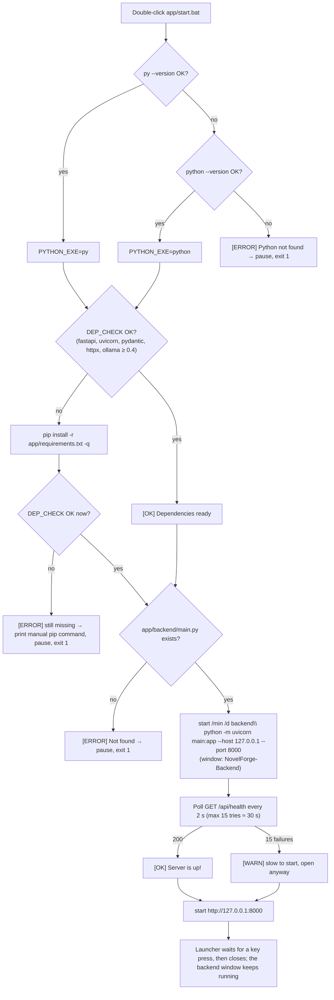
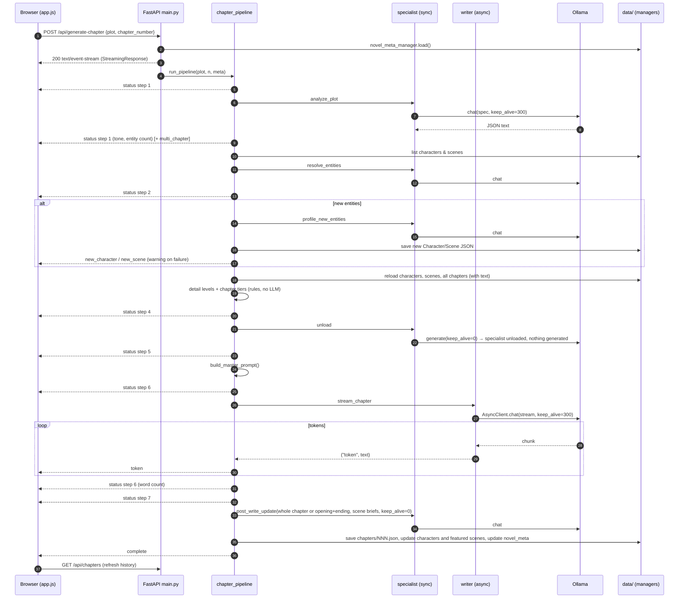
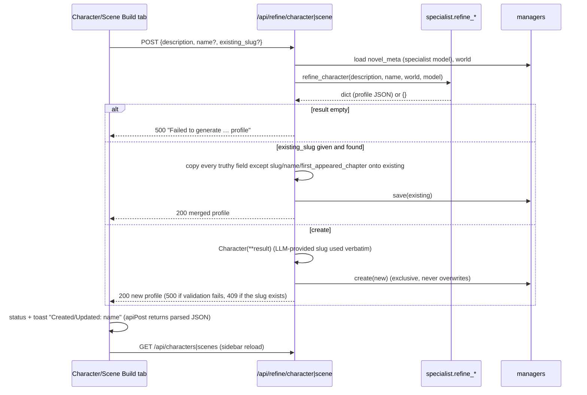

# 02 — Workflows

> **Applies to:** v1.0.0 + [Unreleased]. **Last verified against code:** 2026-11-23.
> Line references (`file:line`) point to v1.0.0 and will drift as code changes. Re-verify before relying on them.

This document describes every end-to-end flow in the application: what triggers it, which components take part, what data is read and written, and how failures behave.

| # | Workflow | Trigger |
|---|---|---|
| W1 | [Application launch](#w1--application-launch-appstartbat) | Double-click `app/start.bat` |
| W2 | [Frontend boot](#w2--frontend-boot) | Browser loads `/` |
| W3 | [Chapter generation (7-step pipeline)](#w3--chapter-generation-the-7-step-pipeline) | **▶ Generate Chapter**, `Ctrl+Enter`, `Alt+G` |
| W4 | [Character / Scene build (refine)](#w4--character--scene-build-refine) | **Refine & Save** buttons |
| W5 | [World build (refine + merge)](#w5--world-build-refine--merge) | **Integrate into World Settings** |
| W6 | [Manual CRUD of characters / locations](#w6--manual-crud-characters--locations) | Sidebar **+ New**, card **Edit/Delete** |
| W7 | [World settings & novel settings editing](#w7--world-settings--novel-settings-editing) | **World Settings**, **⚙ Settings**, title click |
| W8 | [Model management (list / select / pull)](#w8--model-management) | Opening Settings, **Refresh**, **Pull** |
| W9 | [Chapter history & reader](#w9--chapter-history--full-view-reader) | History pill, **⛶ Full View** |
| W10 | [Export](#w10--export) | **📤 Export → .txt / .md** |

---

## W1 — Application launch (`app/start.bat`)

Notes:
- The dependency check (`DEP_CHECK`, `app/start.bat:40`) imports every runtime package and requires `ollama` ≥ 0.4, so a missing or too-old package triggers `pip install -r` (which also upgrades). If the packages are still missing afterwards (no network, pip error), the launcher stops with the manual command instead of starting a broken server. In v1.0.0 it probed only `fastapi` (KI-003, fixed in plan 005).
- Even without `ollama`, the backend itself now starts (the import is optional). Generation and the Build tabs then fail with "ollama Python package not installed: run pip install -r app/requirements.txt".
- To stop the app, close the minimised **NovelForge-Backend** window. The launcher has no stop command.

## W2 — Frontend boot

1. `GET /` → `serve_index()` reads `app/frontend/index.html` and returns it (`main.py:47-52`). The page then loads `/style.css` and `/app.js` through dedicated routes (`main.py:55-62`).
2. `DOMContentLoaded` listener #1 (`app.js:1481`):
   1. `checkConnection()` → `fetch /api/novel-meta` with a 3 s timeout. On a network failure it shows the toast *"⚠ Cannot connect to backend…"* for 8 s.
   2. `init()` → `bindStaticEvents()`, then runs these in parallel with `Promise.allSettled`: `loadNovelMeta`, `loadCharacters`, `loadScenes`, `loadWorld`, `loadChapters`. Then `updateChapterHint()`.
3. `DOMContentLoaded` listener #2 (`app.js:1920`) binds the mode tabs, the three refine buttons and **Refresh models**. (Until plan 006 it also added a second **⚙ Settings** click listener that loaded the models; `openSettingsModal` now does that itself.)
4. Each loader stores its result in `state.*` and renders: sidebars (character/scene cards), header title, chapter count badge, history pills, "CHAPTER N" label.
5. If a loader fails it logs `console.warn` and falls back to empty data. The UI stays usable.

## W3 — Chapter generation (the 7-step pipeline)

### W3.1 Trigger (frontend: `generateChapter()`, `app.js:421-584`)

1. Validates that the plot textarea is not empty and that no generation is running in this tab (`state.isGenerating`).
2. Disables the button, shows **✕ Cancel** next to it, resets and shows the pipeline panel, hides the old output and the multi-chapter notice.
3. `POST`s `/api/generate-chapter` with `{plot}` only. The backend numbers the chapter itself (`get_next_number()`: highest existing number + 1, read from disk), so a gap or a stale page can't overwrite a chapter. The UI shows `nextChapterNumber()` (the same rule over `state.chapters`) while streaming and takes the real number from the `complete` event. (Before plan 006 it sent `count + 1`, which overwrote chapters after a gap: KI-008.)
4. A non-2xx response throws with the server's `detail` (e.g. the **409** "A chapter is already being generated…" when another tab or client is generating), shown as an error toast.
5. Reads the response body as a stream and parses SSE `data:` lines (`parseSSEStream`, `app.js:601-640`). Each JSON event is dispatched by its `type` (see W3.4).
6. **✕ Cancel** → `cancelGeneration()` (`app.js:587-596`) disables the button and `POST`s `/api/generate-chapter/cancel`. The stream then ends with the cancelled `error` event (W3.4). The `finally` block hides **Cancel** and re-enables **Generate** whichever way the run ends.

### W3.2 Backend entry (`main.py:171-207`)

- **One generation at a time** (plan 010, KI-031): if the task in `_generation["task"]` is still running, → **409** `A chapter is already being generated. Wait for it to finish or cancel it.`
- Loads `NovelMeta` from `data/novel_meta.json` to get the model names.
- `chapter_number = req.chapter_number or chapter_manager.get_next_number()`. The frontend sends no number (plan 006), so the backend picks highest + 1.
- Starts `produce()` as an `asyncio.Task` (stored in `_generation`): it iterates `run_pipeline(...)` and puts each SSE string on an `asyncio.Queue`, then `None` when it ends. If the task is cancelled, it first queues `error {"message": "Generation cancelled", "cancelled": true}`.
- Returns `StreamingResponse(event_stream(), media_type="text/event-stream")` with headers `Cache-Control: no-cache`, `X-Accel-Buffering: no`, `Connection: keep-alive`. `event_stream()` yields the queued events until `None`.
- **Stopping:**
  - `POST /api/generate-chapter/cancel` (`main.py:210-217`) cancels the task and waits up to 5 s for it to finish, so the guard is free when it returns.
  - If the client disconnects, Starlette cancels the stream, and `event_stream()`'s `finally` cancels the task. Closing the tab therefore still stops the generation, as before plan 010.
  - Cancellation interrupts the pipeline at its current `await` (an Ollama call or a streamed token). Its `except Exception` doesn't catch `CancelledError`, so the open Ollama request is closed.

### W3.3 Pipeline steps (`app/backend/pipeline/chapter_pipeline.py`)

| Step | UI label | Code | LLM call (model, keep_alive) | Input | Output / side effects | SSE emitted |
|---|---|---|---|---|---|---|
| 1 | Analyze Plot | `:67-82` | `specialist.analyze_plot` (spec, -1) | plot | `tone`, `estimated_chapters`, `entity_mentions{characters[],locations[]}`, `key_events`, `chapter_focus` (only tone, estimated_chapters, entity_mentions are used; each is coerced: `estimated_chapters` numeric text → int, else 1; `tone` → text, else "action"; `entity_mentions` lists of strings only, plan 009, KI-015) | `status{step:1}` ×2. `multi_chapter` if `estimated_chapters > 1` |
| 2 | Extract Entities | `:84-97` | `specialist.resolve_entities` (spec, -1) | mentions + all existing `{name, slug}` pairs | `characters[]`/`scenes[]` with `{name, slug, status: existing\|new, importance}` The result is then canonicalised server-side (`_canonical_entities`, plan 007): matches by slug or name (ignoring case and `-`/`_`) become `existing` with the real slug, everything else `new` with `slug = make_slug(name)`; nameless entries and repeats are dropped. | `status{step:2}` ×2 |
| 3 | Build Profiles | `:99-127` | `specialist.profile_new_entities` (spec, -1). **Skipped when nothing is new** | new names, plot, world brief, tone, chapter number | Creates `Character`/`Scene` objects with `slug = make_slug(profile name)` (never the LLM's slug) and **creates their files** in `data/` with `create()`, which never overwrites (also not an equivalent slug). A slug that already exists keeps the existing profile. | `status{step:3}`, `new_character{name,slug}`, `new_scene{name,slug}`, `warning{message}` on validation failure or an existing slug |
| — | (reload) | `:129-133` | — | — | Re-reads all characters and scenes into `chars_dict` / `scenes_dict` keyed by slug | — |
| 4 | Optimize Context | `:135-167` | **none** (deterministic since plan 008; the old `select_context` prompt only restated these rules, KI-013) | resolved entities with importance, all chapters | `character_detail{slug: full\|compressed}`, `scene_detail{slug: full\|skip}`, `chapter_tiers{"n": tier}`, built by the rules below | `status{step:4}` ×2 |
| 5 | Prepare Model | `:169-177` | `specialist.unload` → `AsyncClient.generate(model, keep_alive=0)`: Ollama's unload request, **no generation** (plan 008, KI-012) | specialist model name | Specialist leaves VRAM before the writer loads. Best-effort: a failure becomes a `warning` and the run continues | `status{step:5}` ×2, `warning{message}` if the unload fails |
| — | (prompt) | `:179-189` | — | world + dicts + chapters + detail maps | `master_prompt` string (see [03 §2.6](03-low-level-design.md#26-appbackendpipelinecontext_builderpy)) | — |
| 6 | Write Chapter | `:191-202` | `writer.stream_chapter` (writer, 300 s, streaming) | master prompt, plot, chapter number | Tokens are appended to `full_text`. `word_count = len(full_text.split())` | `status{step:6}`, many `token{content}`, then `status{step:6}` "Chapter written: N words". `error` → **pipeline returns early, nothing saved** |
| 7 | Summarize & Save | `:204-280` | `specialist.post_write_update` (spec, **0**) | the **whole chapter**, or its opening + ending when it exceeds ~5000 tokens (`_chapter_excerpt`, plan 008, KI-014), primary character briefs, featured (main) scene briefs | Saves `data/chapters/NNN.json`. Updates character `last_seen_chapter`, `arc_notes`, `cultivation_level`, `abilities` (set-union), `relationships` (dict update). Updates a featured scene's `significance` from `scene_updates` (non-empty text only, KI-013). Updates `novel_meta.total_chapters = max(old, n)` | `status{step:7}`, `complete{…}` |
| ✖ | — | `:282-284` | — | any uncaught exception | Nothing further is saved. **Profiles already created in step 3 stay on disk.** | `error{message, detail: traceback}` |

#### Step 4 rules (deterministic)

- **Characters:** `importance == "primary"` → `full`, otherwise → `compressed` (`:142-145`).
- **Scenes:** `importance == "main"` → `full`, otherwise → `skip` (`:146-149`).
- **Chapter tiers**, relative to the chapter being written `N`, for each existing chapter `n` (`:171-184`):

| `N − n` | Tier | What goes into the prompt |
|---|---|---|
| 1 | `full_text` | Last 400 words of that chapter's text (`context_builder.py:83-87`) |
| 2–4 | `full` | `full_summary` (falls back to short, then micro) |
| 5–8 | `short` | `short_summary` (falls back to micro) |
| ≥ 9, or ≤ 0 (e.g. regenerating an earlier chapter) | `micro` | `micro_summary` |

> When regenerating chapter *k* with chapters after *k* already on disk, those **later** chapters are also included in "STORY SO FAR" (as `micro`, because `N − n ≤ 0`). The current chapter's old version is included too.

#### Post-write character update rules

For every slug in `post_data.character_updates` that exists:
`last_seen_chapter = N`. Non-empty `arc_notes` replaces the old value. Non-empty `cultivation_level` replaces the old value. `new_abilities` (a list, or one string) is appended without duplicates, keeping order. `relationship_updates` (a dict) is merged into the existing relationships. All changes are validated together (`Character(**…)`, coercing types); if that fails, a `warning` is sent and the character keeps its old values. Non-dict `character_updates` or entries are ignored (plan 009, KI-015/KI-016). Chapter title and summaries are coerced to text, and an empty title becomes `Chapter N`, so a bad reply can no longer lose the chapter.
Primary characters with no (successful) update still get `last_seen_chapter = N`.
`scene_updates` returned by the LLM update the featured scenes' `significance` (only scenes marked `main` in this chapter, only non-empty text; anything else is ignored). Before plan 008 they were ignored (KI-013).

### W3.4 SSE event contract (backend → frontend)

| `type` | Payload fields | Emitted at | Frontend handler (`app.js:469-570`) |
|---|---|---|---|
| `status` | `step` (1–7), `message` | Start/end of each step | Marks the previous step done, the current one active, writes `message` to the step log, sets progress = step/7 |
| `multi_chapter` | `estimated`, `message` | Step 1 if estimated > 1 | Shows the notice panel + warning toast. The notice is hidden again at the start of the next run (before plan 011 it was always visible, KI-039) |
| `new_character` | `name`, `slug` | Step 3 per saved character | Adds an entity tag, reloads characters after 300 ms, shows a toast |
| `new_scene` | `name`, `slug` | Step 3 per saved scene | Same, for scenes |
| `warning` | `message` | Step 3 profile that can't be saved, step 5 unload failure, step 7 character update that fails validation | Warning toast (6 s) and `console.warn` (since plan 009; before, ignored: KI-018) |
| `token` | `content` | Step 6, per chunk | Appends to the current `
`. Splits paragraphs on `\n\n`. Moves the blinking cursor |
| `error` | `message`, `detail?`, `cancelled?` | Writer error or uncaught exception; `cancelled: true` (message "Generation cancelled") when the generation was cancelled (`main.py:163`, plan 010) | Hides the cursor. Normal errors: error toast and paints the active step red. Cancelled: resets the pipeline steps, sets the output title to "Cancelled (not saved)", info toast "Generation cancelled" |
| `complete` | `chapter_number`, `title`, `word_count`, `characters[]`, `scenes[]`, `micro_summary` | End of step 7 | Marks all steps done, hides the streaming cursor (it really hides since plan 011, KI-037), sets title and word count, `state.currentChapter = {chapter_number, title, word_count, characters_featured, scenes_featured}` (the last two from `characters`/`scenes`, so Full View shows the tags, plan 013, KI-032), sets the badge from `chapter_number`, reloads chapters, characters **and novel meta** (step 7 updated profiles and `total_chapters` on disk; the Edit and Settings modals read that state), clears the plot textarea, success toast |

Wire format: each event is one line `data: {json}\n\n` (`chapter_pipeline.py:20-23`). No `event:` or `id:` fields are used.

### W3.5 Sequence diagram

### W3.6 Failure behaviour summary

| Failure | Result |
|---|---|
| Ollama not running / model missing during steps 1–5 or 7 | Exception → `error` event "Pipeline error: …" with traceback. Nothing saved, except profiles already written in step 3. |
| Specialist returns non-JSON | `_extract_json` returns `{}`. Downstream `.get()` defaults apply: tone "action", no entities, empty summaries. Generation continues with less context. |
| Specialist returns a wrong type (e.g. `"estimated_chapters": "2"`) | Coerced (`as_int`, `as_text`, `as_str_list`), so the pipeline continues (plan 009; before, a `TypeError` aborted it, KI-015). |
| New entity JSON fails Pydantic validation | Most bad values are coerced by the models (e.g. `type: "supporting"` → `temporary`, plan 009). If it still fails (e.g. no name), a `warning` event (a warning toast since plan 009). Entity not saved. Pipeline continues. |
| A "new" entity's profile reuses an existing slug (the specialist missed the match in step 2) | `warning` event "Could not save character profile: Character 'x' already exists". The existing profile is kept unchanged and still used for context. Pipeline continues. (Before plan 004 it was overwritten, KI-036.) |
| Writer error | `error` event "Writer error: …". Pipeline returns **before saving**. Streamed text is lost on the server; the browser still shows it. |
| Browser tab closed mid-stream | Starlette cancels the stream, which cancels the generation task (plan 010). Whatever was not yet saved is lost, and the next generation is accepted at once. |
| **✕ Cancel** pressed | The task is cancelled at its current `await`. The stream ends with `error {cancelled: true}`. Profiles already written in step 3 stay; the chapter is saved only in step 7. A cancel during step 7 can leave the chapter saved with only some character updates applied. |
| A second generation while one runs (another tab or client) | **409** before anything starts (plan 010; before, both ran and wrote the same chapter number, KI-031). |

## W4 — Character / Scene build (refine)

Frontend: `refineCharacter()` (`app.js:1572-1614`) / `refineScene()` (`app.js:1619-1659`).
Backend: `refine_character` (`main.py:378-412`) / `refine_scene` (`main.py:415-447`).

Merge semantics for "Update Existing":
- **Overwrites** each field for which the LLM returned a truthy value. Lists such as `abilities` are **replaced**, not merged.
- The existing `slug`, `name` and `first_appeared_chapter` are always kept.
- Only known model fields are merged. The merged record is validated (and coerced, e.g. `age: 17` → `"17"`, `type: "supporting"` → `temporary`) **before** saving; if validation still fails, the request returns 500 and nothing is saved, so the file stays loadable. (Before plan 009 values were `setattr` without validation and could make the entity vanish, KI-016.)
- Refine calls use `keep_alive=300`, so the specialist stays in VRAM for 5 idle minutes (fast follow-up builds) and is then unloaded (plan 013, KI-029; before, `-1` kept it loaded until a generation unloaded it or Ollama restarted).

## W5 — World build (refine + merge)

Frontend `refineWorld()` (`app.js:1664-1696`) → `POST /api/refine/world` (`main.py:450-477`).

1. The specialist (`specialist.refine_world`) gets a brief of the current world (name, genres, cultivation, magic, hierarchy) and the author's description. It returns the full `WorldSettings` shape, with only the fields that the description touches filled in.
2. Merge into the existing world (`main.py:459-475`):
   - **List fields** (`genre_tags`, `professions`, `hierarchy_levels`, `factions`): the LLM value is read as a list (a single string is one item), then each truthy item that is not already present is appended (exact-string dedupe, order kept). Before plan 009 a string replaced the whole list or caused a 500.
   - **String fields:** replaced when the new value is non-empty.
   - Unknown keys are ignored.
3. Saves `data/world_settings.json` and returns the merged world.
4. The frontend stores the returned world in `state.world` and redraws the snapshot, so the World Settings modal opens with the merged values. (In v1.0.0 it stored the raw `Response`, so saving the modal afterwards wiped the world. KI-002, fixed by plan 003.)

## W6 — Manual CRUD (characters / locations)

| Action | UI | Request | Backend behaviour |
|---|---|---|---|
| Create | **+ New Character / + New Location** → modal → Save | `POST /api/characters` `{character:{slug:"", …}}` / `POST /api/scenes` `{scene:{slug:"", …}}` | Stores `make_slug(slug or name)` (lowercase, `_` separators; letters of any script kept). **422** if that is empty (e.g. `???`). **409** if that slug, or an equivalent one (`elder-wu` vs `elder_wu`), already exists. The UI shows the error and keeps the modal open, so the user can rename. |
| Edit | Card **Edit** (or profile modal **Edit**) → Save | `PUT /api/characters/{slug}` / `PUT /api/scenes/{slug}` with `{...existing record from state, ...form fields}` | 404 if the file is missing. Forces `slug` = path slug. **Full replace** of the file, but the UI sends every field, so the ones the modal doesn't show (`first_appeared_chapter`, `last_seen_chapter`) are kept. |
| Delete | Card **Delete** → `confirm()` | `DELETE /api/characters/{slug}` / `/api/scenes/{slug}` | Deletes the file. 404 if missing. |
| View | Click card / **View** | (no request: uses `state`) | Read-only profile modal. |

> History: in v1.0.0, Create and Edit both failed with HTTP 422, because the payload had no `slug` (KI-001). Plan 003 fixed this in the frontend, together with the reset of the chapter-tracking fields on edit (KI-027). The API contract is unchanged: `slug` is still a required body field.

## W7 — World settings & novel settings editing

- **World Settings modal** (`openWorldModal`/`saveWorld`, `app.js:1013-1060`): fills the form from `state.world` and saves with `PUT /api/world {settings}` (full replace).
- **Novel Settings modal** (`openSettingsModal`/`saveSettings`, `app.js:1065-1105`): title, genre, author, writer model, specialist model → `PUT /api/novel-meta {meta}`. The body is `{...state.novelMeta, …form}`, so `total_chapters` and `created_at` are kept, and an empty model select falls back to the stored model. `state.novelMeta` is reloaded after every generation, so the count is current. Opening the modal (button or **Alt+S**) fills the model lists at once and refreshes them from Ollama (see W8). (KI-006/KI-007, fixed in plan 006.)
- **Inline title edit** (`initTitleEdit`, `app.js:1286-1325`): click the title, type, then Enter or blur → `PUT /api/novel-meta` with `{...state.novelMeta, title}`. This keeps the other fields. Escape cancels.

## W8 — Model management

1. Opening **⚙ Settings** (button or **Alt+S**: both call `openSettingsModal`) first fills both `<select>`s with the current models, then `loadModels()` → `GET /api/models` (cached in `_cachedModels` until **↻ Refresh**) refreshes the lists and the model browser, keeping any choice made meanwhile.
2. Backend (`main.py:280-307`) calls `GET http://localhost:11434/api/tags` (5 s timeout) and annotates `RECOMMENDED_MODELS` with an `installed` flag.
   "Installed" means Ollama lists that exact model (a name without a tag counts as `:latest`, `_model_key`). Since plan 012 a different tag of the same family no longer counts: with only `gemma3:4b` pulled, `gemma3:12b` offers **⬇ Pull**, and `gemma3:4b` appears as its own installed entry (before, it was shown as installed, KI-020).
3. The UI fills both `<select>`s (installed models + current selections, the latter tagged "(not installed)") and renders the model browser cards with **Set Writer / Set Specialist** (installed) or **⬇ Pull** (not installed).
4. **Pull** → `POST /api/models/pull {model}` → the backend streams `POST /api/pull` from Ollama, re-emitting `data: {status, percent, total, completed}`, then `{status:"success", model}` or `{status:"error", message}`.
   - `success` comes only after Ollama's own `{"status": "success"}` line.
   - A non-200 status, an `{"error": …}` line, a stream that ends without success, or an unreachable Ollama each end in `error` (plan 010, KI-019).
   - The UI shows "Pull failed: …" in the card and a toast.
5. Selecting a model only changes the `<select>`. It is saved when the user clicks **Save Settings**.

## W9 — Chapter history & Full View reader

- The history bar shows one pill per chapter from `GET /api/chapters` (summaries only; `full_text` is blanked by the server).
- Clicking a pill → `GET /api/chapters/{n}` → `showChapterOutput()` renders the paragraphs and highlights the pill.
- **⛶ Full View** → `openChapterViewModal()`. It copies the output area's HTML (or formats `full_text`, or fetches the chapter) and shows the featured character/scene **slugs** as tags.
  Right after a generation, `state.currentChapter` only holds `{chapter_number, title, word_count}`, so the featured tags are empty until the chapter is reopened from history.

## W10 — Export

1. `exportNovel(fmt)` creates a temporary `<a href="/api/export/{fmt}">` and clicks it.
2. Backend (`main.py:233-255`) loads all chapters with text, sorted by number, and builds:
   - **md:** `# {title}` then `## Chapter {n}: {title}` + text per chapter.
   - **txt:** `{title}` + `====` underline, then `Chapter {n}: {title}` + 40 dashes + text.
3. Writes the result to `data/{title with spaces→_}.{fmt}` (a side effect that stays on disk), then returns it as a `FileResponse` download.
   A title with characters that are invalid in Windows filenames (`: ? * " < > |`) makes the export fail (KI-017).
