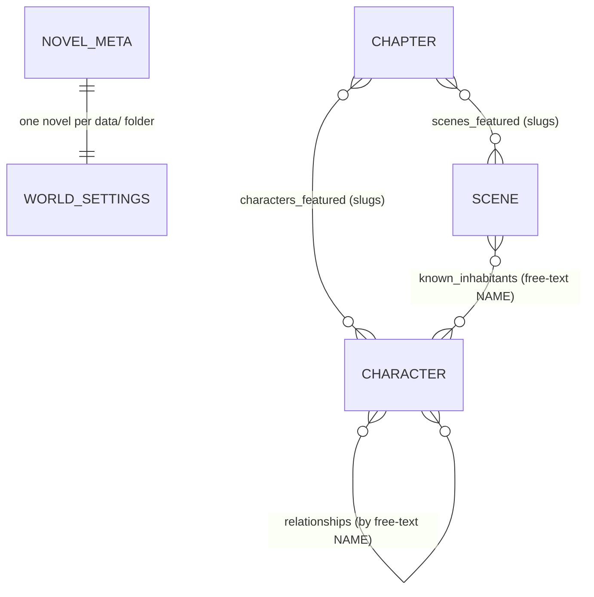

# 05 — Data Model & Storage

> **Applies to:** v1.0.0. **Last verified against code:** 2026-11-22.
> Schema source of truth: `app/backend/models.py`. Storage source of truth: `app/backend/managers/*.py`.

## 1. Storage layout

All data lives in `<repo>/data/`, **outside** the application folder `app/`. Each manager computes the path from its own `__file__` as `Path(__file__).resolve().parents[3] / "data" / …` (`app/backend/managers/x.py` → up 3 levels = repo root), and the export route in `main.py` uses `parents[2]`. The location therefore does not depend on the working directory. If you ever move `app/backend/` deeper or shallower, these six lines must change together. There is no database.

```
data/
├── novel_meta.json                     NovelMeta            (novel_meta_manager)
├── world_settings.json                 WorldSettings        (world_manager)
├── characters/{slug}.json              Character, 1 per file (character_manager)
├── scenes/{slug}.json                  Scene, 1 per file     (scene_manager)
├── chapters/{NNN}.json                 Chapter, 1 per file   (chapter_manager; NNN = zero-padded to 3 digits)
└── {Title_With_Underscores}.{txt|md}   export side-effect files (main.py export route)
```

| Property | Behaviour |
|---|---|
| Encoding | UTF-8, `ensure_ascii=False` (non-Latin names are stored as-is), `indent=2` |
| Directory creation | Lazy: `characters/`, `scenes/` and `chapters/` are created on first access. The root file's parent is created on save. |
| Identity | Filename stem = `slug` (or chapter number). Renaming a character does **not** rename its file. |
| Atomicity | Updates (`save`) overwrite the file directly, with no temp file and no locking. Creating a character or scene (`create`) uses an exclusive `open(…, "x")`, so it never replaces an existing file (also on case-only differences on Windows); a taken slug is a 409 or a pipeline `warning` (KI-036, plan 004). |
| Corruption handling | List operations skip unreadable/invalid files **silently**. Single-item reads raise (→ 500). |
| Versioning / migrations | None. Files are validated against the current Pydantic model on read, so **adding a required field or renaming a field breaks every existing file**. Always add new fields with defaults. |
| One novel per folder | To keep several novels, keep separate copies of `data/` (see [07 §6](07-setup-and-usage.md#6-backup-reset-and-multiple-novels)). |

## 2. Entities

### 2.1 Character — `data/characters/{slug}.json`

| Field | Type | Default | Written by | Read by / used for |
|---|---|---|---|---|
| `name` | str | **required** | UI, LLM (step 3, refine) | Display. Entity resolution (step 2). |
| `slug` | str | **required** | `make_slug()` (manual create, `""` → derived), **LLM verbatim** (step 3, refine) | Filename, references (`characters_featured`, `character_detail` keys) |
| `type` | `"main"` \| `"temporary"` | `"temporary"` | UI select, LLM | Sidebar section (MAIN CAST vs SUPPORTING). Compressed-prompt label. |
| `age` | str \| null | null | UI, LLM | Prompt (`Age:`). ⚠ an int value fails validation. |
| `appearance` | str | "" | UI, LLM | Prompt |
| `personality` | str | "" | UI, LLM | Prompt. Fallback for the compressed line (`[:80]`). |
| `speech_style` | str | "" | UI, LLM | Prompt (`Speech:`) |
| `abilities` | str[] | [] | UI tags, LLM, **step 7 set-union** | Prompt |
| `cultivation_level` | str \| null | null | UI, LLM, **step 7** | Prompt (`Level:`) |
| `backstory` | str | "" | UI, LLM | Prompt |
| `relationships` | {name: description} | {} | UI editor, LLM, **step 7 merge** | Prompt (`Relationships: k: v; …`) |
| `habits` | str[] | [] | UI tags, LLM | Prompt |
| `arc_notes` | str | "" | UI, LLM, **step 7 overwrite** | Prompt (`Current Arc:`). Step 7 input. |
| `first_appeared_chapter` | int | 1 | LLM (step 3: current chapter; refine: 0) | Card meta "Ch. first — last" |
| `last_seen_chapter` | int | 1 | **step 7** (primary characters) | Card meta |
| `micro_summary` | str | "" | UI, LLM | Card summary. Compressed prompt line. |

Example (the committed sample):
```json
{
  "name": "Xiao Fan",
  "slug": "xiao-fan-scientist-inventor",
  "type": "main",
  "age": "60 years old",
  "appearance": "short, bespectacled man with a neat beard and unkempt hair; …",
  "personality": "serious, focused on work to the point of obsession. …",
  "speech_style": "formal and precise when discussing science; …",
  "abilities": ["advanced knowledge in various fields of science", "inventor with a knack for creating innovative gadgets"],
  "cultivation_level": null,
  "backstory": "Xiao Fan dedicated his life to scientific research, …",
  "relationships": {},
  "habits": ["spends long hours in a lab", "keeps detailed notes about every experiment"],
  "arc_notes": "Xiao Fan's arc may involve balancing personal life with professional achievements …",
  "first_appeared_chapter": 0,
  "last_seen_chapter": 1,
  "micro_summary": "A dedicated scientist who experiments tirelessly, dreaming about myths and supernatural powers while remaining grounded in science."
}
```
> Note: this slug is hyphenated and descriptive, so it was produced by the LLM, not by `make_slug()` (which would give `xiao_fan`). Mixed slug styles are normal in v1.0.0 data (KI-009).

### 2.2 Scene — `data/scenes/{slug}.json`

| Field | Type | Default | Written by | Used for |
|---|---|---|---|---|
| `name` | str | **required** | UI, LLM | Display, resolution |
| `slug` | str | **required** | as for Character | Filename, references |
| `scene_type` | str | "" | UI, LLM | Card badge (falls back to "LOCATION"). Prompt `Type:` |
| `description` | str | "" | UI, LLM | Prompt |
| `atmosphere` | str | "" | UI, LLM | Prompt |
| `textures` | str | "" | UI, LLM | Prompt `Textures/Sensory:` |
| `known_inhabitants` | str[] | [] | UI tags, LLM | Prompt `Inhabitants:` (free-text names, not slugs) |
| `significance` | str | "" | UI, LLM | Prompt |
| `first_appeared_chapter` | int | 1 | LLM | Card meta |
| `micro_summary` | str | "" | UI, LLM | Card summary |

Scenes are **never updated by the pipeline** after creation (`scene_updates` is ignored).

### 2.3 Chapter — `data/chapters/{NNN}.json`

| Field | Type | Default | Written by | Used for |
|---|---|---|---|---|
| `chapter_number` | int | **required** | pipeline | Filename, ordering, tiering |
| `title` | str | "" | step 7 LLM (`chapter_title`, fallback `"Chapter N"`) | UI, export, prompt labels |
| `plot_input` | str | "" | pipeline (the author's plot) | Not displayed anywhere |
| `full_text` | str | "" | step 6 (concatenated tokens) | Reader, export, `full_text` tier (last 400 words) |
| `micro_summary` | str | "" | step 7 (15–20 words requested) | `micro` tier |
| `short_summary` | str | "" | step 7 (80–100 words) | `short` tier |
| `full_summary` | str | "" | step 7 (180–220 words) | `full` tier |
| `characters_featured` | str[] (slugs) | [] | pipeline (`primary` characters) | Full View tags |
| `scenes_featured` | str[] (slugs) | [] | pipeline (`main` scenes) | Full View tags |
| `word_count` | int | 0 | `len(full_text.split())` | UI, toasts |
| `created_at` | ISO str | "" | `datetime.now().isoformat()` (local time, no TZ) | Not displayed |

Chapters cannot be edited or deleted through the API or UI. Re-generating with an existing `chapter_number` overwrites the file.

### 2.4 WorldSettings — `data/world_settings.json`

| Field | Type | Merge rule in World Build (`/api/refine/world`) | Prompt line |
|---|---|---|---|
| `world_name` | str | overwrite if non-empty | `World:` |
| `genre_tags` | str[] | append unique | `Genre:` |
| `magic_system` | str | overwrite if non-empty | `Magic System:` |
| `cultivation_system` | str | overwrite if non-empty | `Cultivation System:` |
| `professions` | str[] | append unique | `Professions:` |
| `hierarchy_levels` | str[] (low→high) | append unique | `Hierarchy (low→high):` |
| `factions` | str[] | append unique | `Factions:` |
| `rules_of_the_world` | str | overwrite if non-empty | `World Rules:` |
| `lore_notes` | str | overwrite if non-empty | `Lore Notes:` |

### 2.5 NovelMeta — `data/novel_meta.json`

| Field | Type | Default | Notes |
|---|---|---|---|
| `title` | str | `"Untitled Novel"` | Header, export title/filename |
| `genre` | str | "" | Stored only, not used in prompts |
| `author` | str | "" | Stored only, not exported |
| `total_chapters` | int | 0 | `max(old, n)` after each generation. Kept by Settings saves and title edits since plan 006 (KI-007 reset it to 0 before). The UI shows the chapter-list length instead. |
| `writer_model` | str | `"gemma3:12b"` | Ollama model tag for step 6 |
| `specialist_model` | str | `"phi4-mini:3.8b"` | Ollama model tag for all specialist calls |
| `created_at` | str | "" | Never set |

## 3. Relationships between entities



References are **not enforced**. Deleting a character leaves its slug inside chapters' `characters_featured`. Relationships and inhabitants are free-text names, not slugs.

## 4. How stored data becomes LLM context

| Data | Included when | Form |
|---|---|---|
| World settings | Always (non-empty fields) | Labelled lines |
| Character | Resolved in step 2 **and** exists on disk | `primary` → full profile. Otherwise compressed one-liner. |
| Scene | Resolved in step 2 **and** exists on disk **and** `importance == main` | Full profile. Background scenes are skipped. |
| Previous chapter (N−1) | Always | Last 400 words of text |
| Chapters N−4…N−2 | Always | `full_summary` |
| Chapters N−8…N−5 | Always | `short_summary` |
| Older | Always | `micro_summary` |

Because **every** chapter contributes at least its micro summary, the prompt grows linearly with novel length. The writer's `num_ctx` is 32,768 tokens.

## 5. Sample data shipped in the repository

| File | State |
|---|---|
| `data/novel_meta.json` | Title "Untitled Novel", `total_chapters: 1` (but no `data/chapters/` exists, so the value is inconsistent) |
| `data/world_settings.json` | All empty |
| `data/characters/xiao-fan-scientist-inventor.json` | One main character (60-year-old scientist) |
| `data/scenes/neuroscience-lab-night-stormy-weather.json` | One scene (it names "Dr. Hiroshi Nakamura" as inhabitant, a different character) |
| `data/Untitled_Novel.txt` | Export of an empty novel (title + underline only) |

This is test/user content committed to version control. Consider whether `data/` should be ignored, with a seed/sample folder instead (tracked as tech debt KI-030).
