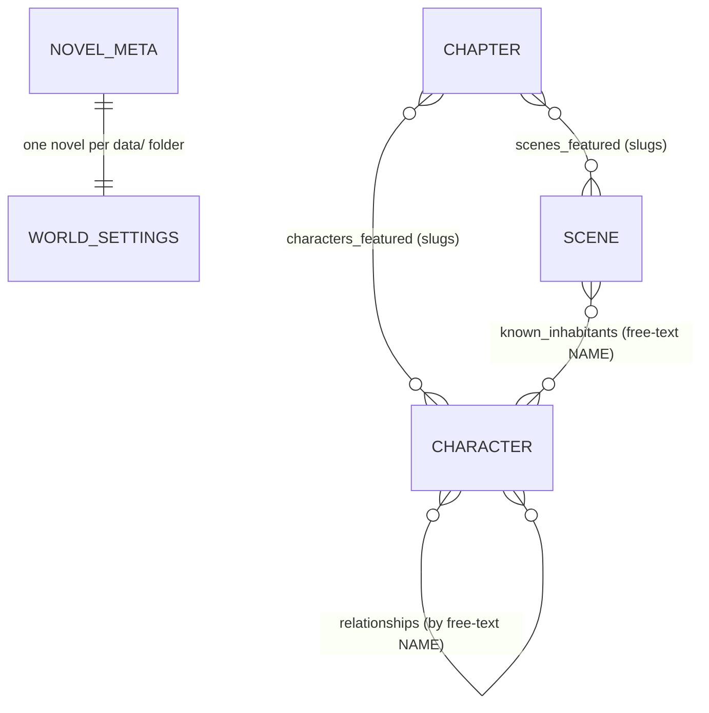

# 05 — Data Model & Storage

> **Applies to:** v2.0.0 + [Unreleased]. **Last verified against code:** 2026-11-22 (§1 path note and export rows: 2026-11-24, plan 015; atomicity and corruption rows: 2026-11-24, plan 016; §1 git note and §5: 2026-11-24, plan 017; `draft.json`, §2.5 `review_drafts`, §2.6, §4 tags: 2026-11-24, plan 019; §4 regenerated chapters: 2026-11-26, plan 022; §2 chapter overwrite note: 2026-11-27, plan 024; §1, §2.3 and §2.7 chapter versions: 2026-11-27, plan 025).
> Schema source of truth: `app/backend/models.py`. Storage source of truth: `app/backend/managers/*.py`.

## 1. Storage layout

All data lives in `<repo>/data/`, **outside** the application folder `app/`. Each manager computes the path from its own `__file__` as `Path(__file__).resolve().parents[3] / "data" / …` (`app/backend/managers/x.py` → up 3 levels = repo root). The location therefore does not depend on the working directory. If you ever move `app/backend/` deeper or shallower, these seven lines must change together (`version_manager` since plan 025). (The export route also wrote here until plan 015; it now writes nothing, KI-017.) There is no database. `data/` is not in git since plan 017 (KI-030, §5).

```
data/
├── novel_meta.json                     NovelMeta            (novel_meta_manager)
├── world_settings.json                 WorldSettings        (world_manager)
├── characters/{slug}.json              Character, 1 per file (character_manager)
├── scenes/{slug}.json                  Scene, 1 per file     (scene_manager)
├── chapters/{NNN}.json                 Chapter, 1 per file   (chapter_manager; NNN = zero-padded to 3 digits)
├── draft.json                          Draft, only while a chapter waits for review (draft_manager, plan 019)
├── chapter_versions/{NNN}-{id}.json    ChapterVersion: the text a regenerated chapter replaced, the newest 5 per chapter
│                                       (version_manager, plan 025; id = YYYYMMDD-HHMMSS-ffffff)
└── {Title_With_Underscores}.{txt|md}   left by exports of older versions (since plan 015 export writes nothing here)
```

| Property | Behaviour |
|---|---|
| Encoding | UTF-8, `ensure_ascii=False` (non-Latin names are stored as-is), `indent=2` |
| Directory creation | Lazy: `characters/`, `scenes/` and `chapters/` are created on first access, `chapter_versions/` when the first chapter is replaced (plan 025). The root file's parent is created on save. |
| Identity | Filename stem = `slug` (or chapter number). Renaming a character does **not** rename its file. Slugs must match `[\w-]+` (letters/digits of any script, `_`, `-`); anything else is refused before touching the disk. New slugs are always derived by the server (`make_slug`: lowercase, `_` separators), so new files are snake_case; older hyphenated files (e.g. `xiao-fan-scientist-inventor`) stay valid and are matched by the equivalence check (plan 007, KI-009/KI-010). |
| Atomicity | Every write is atomic (plan 016, KI-026): `managers/storage.write_json` writes a temp file in the same folder, `fsync`s it, then `os.replace`s it into place, so a crash leaves the old file intact (before, `save` wrote in place). No locking. Creating a character or scene (`create`) uses an atomic exclusive move (`os.link`; an exclusive `open(…, "x")` where hard links aren't supported), so it never replaces an existing file (also on case-only differences on Windows); a taken slug is a 409 or a pipeline `warning` (KI-036, plan 004). |
| Corruption handling | List operations skip unreadable/invalid files and log `WARNING Skipped unreadable <folder>/<file>: <error>` to the server console (plan 016; before, silently). Single-item reads raise (→ 500), except the draft: an unreadable `draft.json` is logged and treated as no draft, so it can't block every generation (plan 019). |
| Versioning / migrations | None. Files are validated against the current Pydantic model on read, so **adding a required field or renaming a field breaks every existing file**. Always add new fields with defaults. |
| Type coercion | Characters, scenes and world settings coerce wrong-typed values on read and write (`models.py`, plan 009): text fields accept numbers/lists/dicts, list fields a single string, chapter numbers numeric text (else 1), `type` anything ("main" → main, else temporary). Files saved with such values by older versions **load again** (they used to be skipped silently) and are written back valid on their next save. Already-valid files load unchanged (verified on the real `data/` files). Only a missing `name`/`slug` or invalid JSON still makes a file unloadable. |
| One novel per folder | To keep several novels, keep separate copies of `data/` (see [07 §6](07-setup-and-usage.md#6-backup-reset-and-multiple-novels)). |

## 2. Entities

### 2.1 Character — `data/characters/{slug}.json`

| Field | Type | Default | Written by | Read by / used for |
|---|---|---|---|---|
| `name` | str | **required** | UI, LLM (step 3, refine) | Display. Entity resolution (step 2). |
| `slug` | str | **required** | `make_slug()` (manual create, `""` → derived), **LLM verbatim** (step 3, refine) | Filename, references (`characters_featured`, `character_detail` keys) |
| `type` | `"main"` \| `"temporary"` | `"temporary"` | UI select, LLM | Sidebar section (MAIN CAST vs SUPPORTING). Compressed-prompt label. Any value reading "main" → `main`; anything else (e.g. `"supporting"`) → `temporary` (plan 009). |
| `age` | str \| null | null | UI, LLM | Prompt (`Age:`). Numbers are stored as text (`17` → `"17"`), `"null"`/`"none"` → null (plan 009). |
| `appearance` | str | "" | UI, LLM | Prompt |
| `personality` | str | "" | UI, LLM | Prompt. Fallback for the compressed line (`[:80]`). |
| `speech_style` | str | "" | UI, LLM | Prompt (`Speech:`) |
| `abilities` | str[] | [] | UI tags, LLM, **step 7 set-union** | Prompt |
| `cultivation_level` | str \| null | null | UI, LLM, **step 7** | Prompt (`Level:`) |
| `backstory` | str | "" | UI, LLM | Prompt |
| `relationships` | {name: description} | {} | UI editor, LLM, **step 7 merge** | Prompt (`Relationships: k: v; …`) |
| `habits` | str[] | [] | UI tags, LLM | Prompt |
| `arc_notes` | str | "" | UI, LLM, **step 7 overwrite** | Prompt (`Current Arc:`). Step 7 input. |
| `first_appeared_chapter` | int | 1 | LLM (step 3: current chapter; refine: 0) | Card meta "Ch. first — last" |
| `last_seen_chapter` | int | 1 | **step 7** (primary characters) | Card meta |
| `micro_summary` | str | "" | UI, LLM | Card summary. Compressed prompt line. |

Example (the committed sample):
```json
{
  "name": "Xiao Fan",
  "slug": "xiao-fan-scientist-inventor",
  "type": "main",
  "age": "60 years old",
  "appearance": "short, bespectacled man with a neat beard and unkempt hair; …",
  "personality": "serious, focused on work to the point of obsession. …",
  "speech_style": "formal and precise when discussing science; …",
  "abilities": ["advanced knowledge in various fields of science", "inventor with a knack for creating innovative gadgets"],
  "cultivation_level": null,
  "backstory": "Xiao Fan dedicated his life to scientific research, …",
  "relationships": {},
  "habits": ["spends long hours in a lab", "keeps detailed notes about every experiment"],
  "arc_notes": "Xiao Fan's arc may involve balancing personal life with professional achievements …",
  "first_appeared_chapter": 0,
  "last_seen_chapter": 1,
  "micro_summary": "A dedicated scientist who experiments tirelessly, dreaming about myths and supernatural powers while remaining grounded in science."
}
```
> Note: this slug is hyphenated and descriptive, so it was produced by the LLM, not by `make_slug()` (which would give `xiao_fan`). Mixed slug styles are normal in v1.0.0 data (KI-009).

### 2.2 Scene — `data/scenes/{slug}.json`

| Field | Type | Default | Written by | Used for |
|---|---|---|---|---|
| `name` | str | **required** | UI, LLM | Display, resolution |
| `slug` | str | **required** | as for Character | Filename, references |
| `scene_type` | str | "" | UI, LLM | Card badge (falls back to "LOCATION"). Prompt `Type:` |
| `description` | str | "" | UI, LLM | Prompt |
| `atmosphere` | str | "" | UI, LLM | Prompt |
| `textures` | str | "" | UI, LLM | Prompt `Textures/Sensory:` |
| `known_inhabitants` | str[] | [] | UI tags, LLM | Prompt `Inhabitants:` (free-text names, not slugs) |
| `significance` | str | "" | UI, LLM | Prompt |
| `first_appeared_chapter` | int | 1 | LLM | Card meta |
| `micro_summary` | str | "" | UI, LLM | Card summary |

After each chapter, step 7 may update a **featured** scene's `significance` (scenes marked `main` in that chapter; non-empty text from `scene_updates` only). Other scene fields are never changed by the pipeline (plan 008, KI-013).

### 2.3 Chapter — `data/chapters/{NNN}.json`

| Field | Type | Default | Written by | Used for |
|---|---|---|---|---|
| `chapter_number` | int | **required** | pipeline | Filename, ordering, tiering |
| `title` | str | "" | step 7 LLM (`chapter_title`, fallback `"Chapter N"`) | UI, export, prompt labels |
| `plot_input` | str | "" | pipeline (the author's plot) | Full View **Prompt used** and reuse (plan 019), ⟳ Regenerate (plan 024) |
| `full_text` | str | "" | step 6 (concatenated tokens) | Reader, export, `full_text` tier (last 400 words) |
| `micro_summary` | str | "" | step 7 (15–20 words requested) | `micro` tier |
| `short_summary` | str | "" | step 7 (80–100 words) | `short` tier |
| `full_summary` | str | "" | step 7 (180–220 words) | `full` tier |
| `characters_featured` | str[] (slugs) | [] | pipeline (`primary` characters) | Full View tags |
| `scenes_featured` | str[] (slugs) | [] | pipeline (`main` scenes) | Full View tags |
| `word_count` | int | 0 | `len(full_text.split())` | UI, toasts |
| `created_at` | ISO str | "" | `datetime.now().isoformat()` (local time, no TZ) | Not displayed |

Chapters cannot be edited or deleted through the API or UI. Regenerating one overwrites its file: through the API with an existing `chapter_number`, or in the UI with **⟳ Regenerate**, which always goes through a draft, so the file is replaced only when that draft is approved (plan 024). Numbers below 1 are rejected (422, KI-045). The text it replaces is kept as an older version (§2.7, plan 025).

### 2.4 WorldSettings — `data/world_settings.json`

| Field | Type | Merge rule in World Build (`/api/refine/world`) | Prompt line |
|---|---|---|---|
| `world_name` | str | overwrite if non-empty | `World:` |
| `genre_tags` | str[] | append unique | `Genre:` |
| `magic_system` | str | overwrite if non-empty | `Magic System:` |
| `cultivation_system` | str | overwrite if non-empty | `Cultivation System:` |
| `professions` | str[] | append unique | `Professions:` |
| `hierarchy_levels` | str[] (low→high) | append unique | `Hierarchy (low→high):` |
| `factions` | str[] | append unique | `Factions:` |
| `rules_of_the_world` | str | overwrite if non-empty | `World Rules:` |
| `lore_notes` | str | overwrite if non-empty | `Lore Notes:` |

### 2.5 NovelMeta — `data/novel_meta.json`

| Field | Type | Default | Notes |
|---|---|---|---|
| `title` | str | `"Untitled Novel"` | Header, export title/filename |
| `genre` | str | "" | Stored only, not used in prompts |
| `author` | str | "" | Stored only, not exported |
| `total_chapters` | int | 0 | `max(old, n)` after each generation. Kept by Settings saves and title edits since plan 006 (KI-007 reset it to 0 before). The UI shows the chapter-list length instead. |
| `writer_model` | str | `"gemma3:12b"` | Ollama model tag for step 6 |
| `specialist_model` | str | `"phi4-mini:3.8b"` | Ollama model tag for all specialist calls |
| `created_at` | str | "" | Never set |
| `review_drafts` | bool | `true` | Plan 019. The UI's "Review each chapter as a draft before saving" setting, sent as `review` with each generation. Files written before plan 019 load with `true`. |

### 2.6 Draft — `data/draft.json` (plan 019)

A written chapter that waits for review: at most one, written by the pipeline right after step 6 (in every mode), deleted as the last action of step 7 (approval or one-click) or on discard.

| Field | Type | Default | Notes |
|---|---|---|---|
| `chapter_number` | int | **required** | The number the chapter gets when approved |
| `plot_input` | str | "" | The plot it was written from; becomes the chapter's `plot_input` |
| `full_text` | str | "" | The text, edited by the author (autosave) and by AI rewrites |
| `title` | str | "" | Optional author title; empty = the specialist suggests one at approval |
| `characters_featured` / `scenes_featured` | str[] | [] | Slugs (primary characters, main locations), as on `Chapter` |
| `new_characters` / `new_scenes` | str[] | [] | Slugs step 3 created for this draft; discard offers to delete them |
| `created_at` / `updated_at` | str | "" | ISO timestamps |

A draft is not a chapter: it isn't listed, exported or used as context until it is approved. While it exists, a new generation is refused (409).

### 2.7 ChapterVersion — `data/chapter_versions/{NNN}-{version_id}.json` (plan 025)

The text a chapter had before a regeneration replaced it. Step 7 writes it right before it saves a chapter over an existing one with a different text; a failed write stops the save, so the old text is never lost (the draft stays). Only the **newest 5** per chapter are kept (`version_manager.KEEP`); writing a 6th deletes the oldest (logged).

| Field | Type | Default | Notes |
|---|---|---|---|
| every `Chapter` field (§2.3) | | | As the chapter was when it was replaced, including its summaries and `created_at` |
| `version_id` | str | "" | `YYYYMMDD-HHMMSS-ffffff`: when it was replaced; also the file name after `{NNN}-`. Sorts chronologically |
| `replaced_at` | ISO str | "" | The same moment as an ISO timestamp (local time, no TZ) |

Versions are read, deleted and restored through `/api/chapters/{n}/versions…` ([04](04-api-reference.md#chapter-versions-plan-025)). Restoring one saves it back as chapter *n* (without `version_id`/`replaced_at`) and keeps the text it replaces as a new version. Versions are not chapters: they aren't listed with the chapters, exported or used as context. Deleting a chapter file by hand leaves its versions in place.

## 3. Relationships between entities



References are **not enforced**. Deleting a character leaves its slug inside chapters' `characters_featured`. Relationships and inhabitants are free-text names, not slugs.

## 4. How stored data becomes LLM context

| Data | Included when | Form |
|---|---|---|
| World settings | Always (non-empty fields) | Labelled lines |
| Character | Resolved in step 2, or tagged with `@` in the plot (plan 019), **and** exists on disk | `primary` (always for a tagged one) → full profile. Otherwise compressed one-liner. |
| Scene | Resolved in step 2, or tagged with `@`, **and** exists on disk **and** `importance == main` (always for a tagged one) | Full profile. Background scenes are skipped. |
| Previous chapter (N−1) | Always | Last 400 words of text |
| Chapters N−4…N−2 | Always | `full_summary` |
| Chapters N−8…N−5 | Always | `short_summary` |
| Older | Always | `micro_summary` |
| Chapter N itself (its old version) | Never: left out when it is regenerated (plan 022) | — |
| Chapters after N | Only when an earlier chapter is regenerated | `micro_summary` in a separate "LATER IN THE STORY" section, with "stay consistent, don't reveal" (plan 022, KI-043) |

Because **every** chapter contributes at least its micro summary, the prompt grows linearly with novel length. The writer's `num_ctx` is 32,768 tokens.

## 5. `data/` and version control

Since plan 017 (KI-030, decision D-014), **`data/` is not in git**. `.gitignore` ignores `/data/`, so the novel stays on the user's machine and nothing in it reaches a commit.

- **Fresh clone:** there is no `data/` folder. The app starts with an empty novel: default novel meta and world settings, empty lists. The folders appear when first used.
- **Backups:** git no longer backs up the novel. Copy `data/` yourself (see [07 §6](07-setup-and-usage.md#6-backup-reset-and-multiple-novels)).
- **Old history:** commits before plan 017 still contain the five files tracked then (history was not rewritten):
  - `novel_meta.json`, with `total_chapters: 1` but no chapters
  - an empty `world_settings.json`
  - one character and one location
  - `Untitled_Novel.txt`, an old export
- **Other clones:** pulling the plan 017 commit deletes those five files from that clone's working copy, as for any file removed from git. Back them up first if they matter there.
- **Tests** never touch `data/`. An autouse fixture points every manager at a temp folder, and a session guard compares a snapshot of the real `data/` before and after the run (`real_data_untouched` in `app/tests/conftest.py`). Since plan 019 the snapshot also holds folder mtimes, so a file created and deleted again during the run is caught too.
